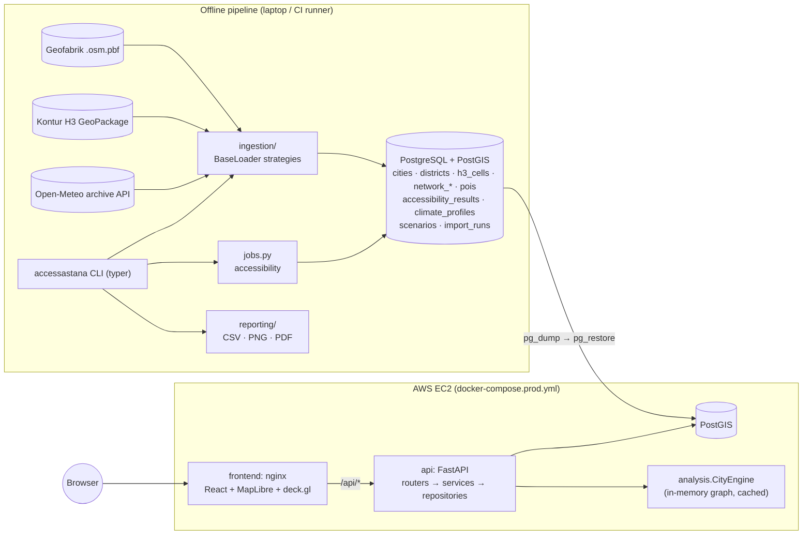

# Architecture

AccessAstana is a **modular monolith**: one repository, one Python package
(`accessastana`) with strictly layered modules, a separate React SPA, and
PostgreSQL/PostGIS. It runs as three containers in production (db, api,
frontend). Heavy preprocessing (ingestion and analysis) runs **offline**, and
the server mostly serves precomputed results.

## Module boundaries

| Module | Responsibility | May import |
|---|---|---|
| `config.py`, `settings.py` | YAML config (validated with pydantic) and env-var settings | — |
| `db/` | SQLAlchemy models, sessions, shared repositories (engine loading) | `analysis` (to build the engine) |
| `ingestion/` | one loader per source, writes the DB | `db`, `analysis.climate` |
| `analysis/` | **pure** algorithms on numpy/pandas/scipy, with no DB or HTTP | `config` only |
| `jobs.py` | batch computations that persist results | `analysis`, `db` |
| `reporting/` | tables, figures and PDF from the DB | `analysis`, `db` |
| `api/` | HTTP layer (routers → services → repositories) | `analysis`, `db` |

Because `analysis/` has no I/O, every algorithm is unit-tested on synthetic
inputs with known answers (grid graphs, toy facility-location instances).

## Design decisions

**Why a modular monolith, not microservices.** A team of 3–4 people with one
EC2 instance needs simple deployment and debugging. The domain is one bounded
context (accessibility of one city), and the expensive parts run offline. The
modules still have explicit one-way dependencies (table above), so a module
such as `analysis` could be extracted into a worker service later without
rewriting it.

**Why PostGIS.** The spatial data (boundaries, cells, network, POIs) needs
geometry types, spatial indexes (GiST) and spatial SQL such as
`ST_AsGeoJSON`, `ST_X` and joins for the API. It is the standard open-source
spatial database, and the official `postgis/postgis` image deploys anywhere.

**Why H3 (resolution 8) for analysis units.** Kontur population is published
on H3 r8, so using the same grid avoids resampling error. Hexagons have uniform
neighbour distances and near-equal areas (≈0.74 km²), which makes cells
comparable across districts and cities. deck.gl renders H3 ids directly
(`H3HexagonLayer`), so the API sends ids instead of polygons and keeps payloads
small.

**Why H3 is computed in Python, not with the h3-pg extension.** The official
PostGIS image does not ship h3-pg (verified in Phase 1). All H3 work (cover,
centroids, cell polygons) happens once, during ingestion, so the database only
stores `text` ids and pre-built polygons.

**Why scipy Dijkstra instead of pandana.** pandana needs a C++ build on
Python 3.12/arm64. scipy's `csgraph.dijkstra` with `min_only=True`, combined
with **one virtual node per facility** (edge weight = snap distance), solves
the nearest-facility problem for all ~900 cells and all facilities of a
category in a single run (< 0.2 s on 56k nodes). See `analysis/graph.py`.

**Why routing distance once, seasons as a scaling.** Season profiles change
walking *speed* and the acceptable *time*, not the street network, so
`minutes = distance / speed` is exact and one shortest-path run serves all
seasons. A season-specific network (e.g. unploughed park paths) is a natural
extension: build a second `WalkGraph` with filtered edges.

**Why OSMnx through OSM XML.** OSMnx simplifies topology and keeps the largest
connected component, but it cannot read `.pbf`. We filter walkable ways from
the pinned Geofabrik file with pyosmium, write OSM XML, and call
`ox.graph_from_xml`. This avoids depending on a live Overpass API, so the
network is reproducible from one versioned file.

**Why OR-Tools (CBC).** PuLP 4.x no longer bundles CBC and has a new,
breaking API. OR-Tools ships CBC/SCIP/HiGHS wheels for all platforms and has a
stable `pywraplp` API.

**Population calibration.** Kontur (2023-11) sums to 53% of the official
2025 population, so cells are rescaled to official control totals, per
district when those are available. See `ingestion/kontur.py` and
`docs/data-sources.md`.

## Design patterns and where they are used

| Pattern | Where | Why |
|---|---|---|
| **Strategy** | `ingestion/*Loader` behind `BaseLoader`; the CLI selects by name (`ingestion/__init__.py:available_loaders`) | Adding a data source (e.g. another population model) = one new class; the CLI does not change |
| **Template Method** | `BaseLoader.run()` | Checksum → skip-if-unchanged → extract → replace in one transaction → audit row; subclasses only implement `extract`/`load` |
| **Repository** | `db/repositories.py`, `api/repositories/` | SQL is isolated from business logic; services are tested through the API with a real PostGIS |
| **Service layer** | `api/services/` | Routers only translate HTTP ↔ domain; validation and orchestration live in services |
| **Facade** | `analysis/engine.py:CityEngine` | One object for graph + cells + facilities + scenarios + optimisation |
| **Dependency Injection** | `api/deps.py`, `create_app(maker, engine_loader, report_builder)` | Tests inject a test DB and builders without monkey-patching |
| **Cache / lazy singleton** | `api/services.EngineCache` | The read-only city graph is loaded once per process and shared between requests |
| **Application factory** | `api/main.py:create_app` | Several app instances with different config (prod, tests) |

## Idempotent, versioned imports

Each run of a loader writes an `import_runs` row with the SHA-256 of its input
files plus the relevant config. If a successful run with the same checksum
exists, the import is skipped. Otherwise the loader replaces its own rows for
the city inside one transaction. The report prints the `import_runs` table,
so every number in the paper can be traced to exact input versions.

## Request flow examples

- `GET /accessibility?category=school&season=winter` → `AccessibilityRepository`
  reads precomputed `accessibility_results` (no routing at request time).
- `POST /scenarios` → `ScenarioService` → `CityEngine.scenario()`. Only cells
  whose nearest facility was removed, or that are closer to a new facility, are
  recomputed (`analysis/scenarios.py`). A unit test proves this equals a full
  recomputation. Latency is about 0.1–0.5 s for Astana.
- `POST /optimize` → MCLP / p-median on populated cells as candidates
  (≈560 × 560, sparse). CBC solves k ≤ 20 in under a second.

## UML and design diagrams

All diagrams are generated from sources in `docs/diagrams/`
(`./scripts/render_diagrams.sh`, `uv run python scripts/draw_uml_wireframes.py`).

| Diagram | File |
|---|---|
| Component diagram (UML) | `docs/diagrams/png/components.png` |
| Deployment diagram (UML) | `docs/diagrams/png/deployment.png` |
| Use-case diagram (UML) | `docs/diagrams/png/usecases.png` |
| Class diagram: Strategy + Template Method in ingestion | `docs/diagrams/png/classes_ingestion.png` |
| Sequence diagram: `POST /scenarios` | `docs/diagrams/png/sequence_scenario.png` |
| Data model (ER) | `docs/diagrams/png/er.png` |
| Data pipeline | `docs/diagrams/png/pipeline.png` |
| Low-fidelity wireframes | `docs/diagrams/png/wireframe_overview.png`, `wireframe_scenario.png` |

## Architecture style: alternatives considered

| Criterion | Modular monolith (chosen) | Microservices | Event-driven |
|---|---|---|---|
| Team of 3–4, one semester | one repo, one deploy, simple debugging | per-service CI/CD, contracts, tracing: high overhead | needs a broker (Kafka/RabbitMQ) and eventual-consistency handling |
| Workload | heavy batch offline + light read API | could scale the API separately, which is not needed at this load | the data changes rarely (one import per OSM snapshot), so there is nothing to stream |
| Infrastructure | one EC2 instance (AWS Academy) | several services and possibly a gateway | an extra broker container |
| Evolution path | modules have one-way dependencies, so `analysis` can become a worker service later | — | an import-finished event could trigger recomputation later |

## Patterns: used, and deliberately not used

Used (with code locations): Strategy, Template Method, Repository, Service Layer,
Facade, Dependency Injection, Application Factory (table above). Two more:
- **Simple Factory / registry:** `ingestion/__init__.py:available_loaders` maps a name to a loader class.
- **Process-wide single instance:** `settings.get_settings()` and `db.session.get_engine()` are
  cached with `lru_cache`; `api/services.EngineCache` holds one engine per city. This is the
  Singleton intent without a global mutable class.
- **Frontend:** component-based React. State lives in React Context + `useReducer`
  (`frontend/src/state`): a one-way, Flux-like data flow in which components subscribe to the
  store and re-render on change (observer-like subscription provided by React).

Not used, and why: classic server-side **MVC** (the server renders no views; the SPA plus JSON
API split takes its place); an explicit **Observer**/event bus in the backend (no asynchronous
domain events; imports are batch jobs).
