<!--
Черновик пояснительной записки. Его превращает в DOCX скрипт docs/final/build.py.
Соглашения разметки: «# » — раздел (с новой страницы), «## » / «### » — подразделы;
 — рисунок (нумеруется автоматически); строка «Таблица: подпись»
перед таблицей — подпись таблицы; блок ```formula — формулы (нумеруются);
[n] — ссылка на источник из списка литературы.
-->

<!-- title -->
Astana IT University
School of Software Engineering

Дисциплина «Applied Software Development Project» (ASDP)
Образовательная программа 7M06105 «Computer Science and Engineering»

ПОЯСНИТЕЛЬНАЯ ЗАПИСКА
к командному проекту

AccessAstana: климатически скорректированная пешеходная доступность социальной инфраструктуры Астаны по открытым данным

Выполнили: [ЗАПОЛНИТЬ: ФИО участников, группа]

Преподаватели:
Кашкимбаева Н., PhD, ассистент-профессор
Аканова А., PhD, ассоциированный профессор

Астана, 2026
<!-- /title -->

# АННОТАЦИЯ

Записка описывает командный проект AccessAstana — программную систему для оценки
пешеходной доступности социальной инфраструктуры Астаны по открытым данным с учётом
климата. Город покрыт сеткой гексагонов H3 разрешения 8 (903 ячейки, из них 559
населённых). Для каждой ячейки по пешеходной сети OpenStreetMap (56 266 узлов,
5 930 км) рассчитывается время до ближайших объектов семи категорий: школ,
детских садов, поликлиник, аптек, остановок общественного транспорта, продуктовых
магазинов и парков. Время считается для трёх сезонных профилей: лето, типичный
зимний день и день сильного мороза. Параметры профилей взяты из наблюдений скорости
ходьбы на зимних покрытиях и шкалы индекса охлаждения ветром. Доля дней сильного
мороза (27,8% дней декабря–февраля) получена по данным реанализа Open-Meteo
за 2015–2024 гг. Население Kontur Population откалибровано к официальной численности
(1 528 887 человек на 01.01.2025).

Летом в пределах 15 минут пешком от поликлиники живёт 45,2% жителей, от школы —
60,7%. В день сильного мороза эти доли падают до 20,8% и 29,4%. Основной вклад в
падение даёт сокращение допустимого времени пути, а не снижение скорости.
Задачи максимального покрытия и p-медианы, решаемые в системе, показывают, что пять
новых поликлиник могут дополнительно охватить до 105 860 жителей летом.

Система реализована как модульный монолит (Python 3.12, PostgreSQL/PostGIS, FastAPI,
React/MapLibre/deck.gl) с воспроизводимым офлайн-пайплайном, автоматическими
тестами (покрытие ядра 98%) и развёртыванием в Docker. Приведены требования,
архитектура, методы, результаты, управление проектом, модельный бюджет по нормам
грантового финансирования и заявление об использовании генеративного ИИ.

Ключевые слова: пешеходная доступность, город 15 минут, OpenStreetMap, H3, зимняя
мобильность, задача максимального покрытия, p-медиана, Астана.

# СОДЕРЖАНИЕ

<!-- toc -->

# ВВЕДЕНИЕ

**Актуальность.** Концепция «города 15 минут» (15-minute city) предлагает
организовать город так, чтобы повседневные функции были доступны пешком или на
велосипеде за короткое время [1]. Её критикуют за то, что идея не нова и смещает
акцент на близость функций внутри района [2]. Для измерения доступности
предложены метрики «x-минутного города» [3]. Исследования показывают, что
доступность зависит от индивидуальных и временных условий: в Хельсинки скорость
ходьбы в сухой и зимний сезоны различается, и в худшем комбинированном сценарии
15-минутный пеший доступ к ближайшему продуктовому магазину есть лишь у 34%
пожилых людей против 93% в базовом сценарии [4].

Для Астаны климатический фактор особенно значим. По данным реанализа за
2015–2024 гг. средняя температура декабря–февраля составляет −11,9 °C, а в 251
из 903 зимних дней (27,8%) индекс охлаждения ветром опускается до −28 и ниже.
При таких значениях открытая кожа может обморозиться за 10–30 минут [13].
Одновременно город быстро растёт: численность населения на 01.01.2025 —
1 528 887 человек [32]. Население, распределение которого моделирует глобальный
продукт Kontur (2023-11), занижено почти вдвое (814 833 человека в границах
города). Без учёта климата и корректного населения доступность социальной
инфраструктуры оценивается неверно.

Проект соответствует приоритетному направлению конкурсной документации
грантового финансирования на 2026–2028 гг. **«Энергия, передовые материалы и
транспорт»**. Предмет работы — пешеходная мобильность как часть городской
транспортной системы: время пешком до остановок общественного транспорта и
социальных объектов, его сезонная изменчивость и выбор мест для новых объектов,
сокращающий пешие пути. Направление «Экология, окружающая среда и рациональное
природопользование» подходит хуже, потому что климат здесь выступает условием
среды, влияющим на мобильность, а не объектом охраны.

**Цель работы** — разработать воспроизводимую программную систему оценки
климатически скорректированной пешеходной доступности социальной инфраструктуры
Астаны по открытым данным и поддержки решений о размещении новых объектов.

**Задачи:**
1. Исследовать доступные открытые данные (OSM, Kontur, Open-Meteo, официальная
   статистика), оценить их полноту и ограничения.
2. Сформулировать функциональные и нефункциональные требования, пользовательские
   истории и варианты использования.
3. Спроектировать архитектуру (модульный монолит) и модель данных (PostGIS, H3).
4. Реализовать воспроизводимый пайплайн загрузки данных и расчёта сетевой
   доступности для трёх сезонных профилей.
5. Реализовать модели размещения объектов (максимальное покрытие, p-медиана) и
   сценарии «что если».
6. Реализовать REST API и веб-интерфейс с картой, на трёх языках.
7. Обеспечить качество: автоматические тесты, статический анализ, CI/CD, Docker.
8. Получить и проанализировать результаты для Астаны, включая чувствительность
   к допущениям.
9. Подготовить модельный бюджет по нормам грантового финансирования, провести
   финансовый обзор и ретроспективу.

**Объект исследования** — система социальной инфраструктуры и пешеходная сеть
города Астаны. **Предмет исследования** — методы и программные средства оценки
пешеходной доступности с учётом сезонных климатических условий и оптимизации
размещения объектов.

**Научная новизна:**
1. Предложена и реализована методика климатически скорректированной доступности
   «города 15 минут» для резко континентального климата. Сезонные профили задают
   скорость ходьбы по данным наблюдений на зимних покрытиях [10] и допустимое время
   по шкале индекса охлаждения ветром [13]. Доли дней каждого профиля вычисляются
   из многолетних данных реанализа для конкретного города, а «ожидаемый зимний день»
   определяется как взвешенная по числу дней смесь профилей.
2. Модели размещения объектов (максимальное покрытие и p-медиана с учётом
   существующих объектов) решаются на сетевых расстояниях между ячейками H3 для
   каждого сезонного профиля. Сценарии пересчитываются инкрементно, только для
   затронутых ячеек, и результат доказуемо совпадает с полным пересчётом.

Исходно планировавшаяся третья компонента — оценка полноты OSM сравнением с
официальными реестрами объектов — исключена из объёма работ. Открытого
машиночитаемого реестра с координатами нет (подробнее в разделах 3.6 и 4.5),
и полнота OSM рассматривается как ограничение и направление дальнейшей работы.

**Практическая значимость.** Система позволяет сотрудникам акимата и
исследователям:
- выявлять районы с низкой доступностью (например, у Байқоңыр и Сарайшық
  15-минутный индекс 0,43–0,44 против 0,74 у Сарыарқа);
- проверять эффект строительства или закрытия объектов за доли секунды;
- получать обоснованные предложения по размещению объектов.

Код, данные и пайплайн воспроизводимы, а новый город Казахстана добавляется одним
конфигурационным файлом.

# 1. ОБЗОР ЛИТЕРАТУРЫ И АНАЛИЗ ТЕКУЩЕГО СОСТОЯНИЯ

## 1.1. Доступность и «город 15 минут»

Понятие доступности (accessibility) как количественной характеристики
пространства было операционализировано Хансеном [5]. Он предложил метод
определения пространственных паттернов доступности в метрополиях и использовал
доступность как основу модели жилого землепользования. Обзор подходов к оценке
доступности в стратегиях землепользования и транспорта дан в [6]. Глобальная
карта времени поездки до городов [7] показывает, что временная доступность —
стандартная мера неравенства в доступе к услугам.

Концепция «города 15 минут» сформулирована К. Морено в 2016 г. и описана как
«хроно-урбанизм» (chrono-urbanism) [1]. Позукиду и Хациянаки рассмотрели три
города, принявшие эту модель, по критериям инклюзивности, безопасности и
здоровья. Они отмечают, что подход опирается на давно сложившиеся принципы
планирования и смещает акцент на близость функций внутри района [2]. Логан и др.
предложили метрики 10-, 15- и 20-минутного города [3]. В настоящей работе принята
кумулятивная метрика: доля жителей, у которых объект находится в пределах
порогового времени. Она интерпретируема и используется в планировании.

## 1.2. Сезонная и индивидуальная изменчивость пешеходной доступности

Классические модели доступности предполагают постоянную скорость ходьбы. Виллберг,
Финк и Тойвонен записали скорости ходьбы в Хельсинкском регионе в сухой и зимний
сезоны и встроили их в модель доступности [4]. По отдельности наибольший эффект
даёт суточная вариация (часы работы), а в худшем комбинированном сценарии
15-минутный пеший доступ к продуктовому магазину есть лишь у 34% пожилых при
базовом уровне 93%. Фоссум и Рюенг [10] в натурных наблюдениях в Тронхейме
(ноябрь 2019 — март 2020, от −12 до +8 °C) получили модельные средние скорости
на ровной поверхности: 1,511 м/с на асфальте, 1,403 на плотном снеге, 1,378 на
рыхлом снеге, 1,361 на посыпанном льду и 1,257 м/с на чистом льду (N = 1 631).
Лян и др. [11] показали, что средняя скорость ходьбы отрицательно коррелирует с
кажущейся температурой (с временным лагом), а на заснеженной поверхности она на
≈ 0,102 м/с ниже, чем на чистой. Для базовой скорости важны данные Кноблауха и
др. [12]: 15-й процентиль скорости перехода улицы — 1,25 м/с у пешеходов
14–64 лет и 0,97 м/с у пешеходов 65 лет и старше; рекомендованные проектные
значения — 1,22 и 0,91 м/с. Сезонная перестройка доступности моделировалась и
для региональных транспортных систем Арктики [26], но там речь идёт о сетях
дорог, а не о пешеходах.

Критерий опасности холода принят по шкале индекса охлаждения ветром (Wind Chill
Index) Environment and Climate Change Canada [13]: при значениях от −28 до −39
риск высокий, и «открытая кожа может обморозиться за 10–30 минут». Формула индекса
введена в 2001 г. и основана на модели теплового потока с наветренной стороны
цилиндра размером с голову, движущегося со скоростью ходьбы [14].

## 1.3. Размещение объектов

Задача максимального покрытия (Maximal Covering Location Problem, MCLP)
сформулирована Чёрчем и Ревеллом [15]. Задача p-медианы восходит к работе Хакими
[16]: оптимальное положение switching center всегда находится в вершине сети.
Её формулировка как задачи целочисленного линейного программирования дана в
[17]. Обе модели используются при планировании социальных объектов: первая
максимизирует число людей в пределах норматива, вторая минимизирует суммарное
(среднее) время пути.

## 1.4. Открытые пространственные данные

OpenStreetMap (OSM) — краудсорсинговая база с лицензией ODbL. Хаклай [8] при
сравнении с Ordnance Survey для Лондона и Англии получил среднюю позиционную
точность OSM около 6 м и перекрытие объектов категории motorway около 80%.
Баррингтон-Ли и Миллард-Болл [9] оценили глобальную полноту дорожной сети OSM в
≈ 83%. Полнота точечных объектов (школ, поликлиник) остаётся открытым вопросом
для каждой страны. OSMnx [18] автоматизирует построение и упрощение топологии
уличных сетей OSM. Иерархическая гексагональная сетка H3 [19] разбивает мир на
шестиугольные ячейки; на ней публикуется глобальная модель населения Kontur
Population [20], построенная объединением GHSL, Facebook HRSL и ограничений по OSM.
Погодные данные Open-Meteo [22] основаны на реанализах, включая ERA5 [21]
(горизонтальное разрешение 31 км, ежечасная выдача).

## 1.5. Текущее состояние для Астаны

Рецензируемых работ о сетевой пешеходной доступности именно в Астане найти не
удалось: в Crossref и при веб-поиске таких публикаций нет (поиск 16.11.2026).
Контекстная работа [25] отмечает, что крупные государственные инвестиции
обеспечили городу широкий доступ к социальным услугам, а строительный бум привёл
к потере «зелёных и голубых» территорий. Анализ данных в рамках проекта (фаза 0)
выявил следующие тренды и проблемы:
- **быстрый рост населения**: 1 528 887 человек на 01.01.2025 [32], тогда как
  модель Kontur 2023-11 даёт для границ города 814 833 (53%), а тег `population`
  в OSM — 814 400 (устарел);
- **неполнота и неоднородность OSM**: адреса указаны лишь у ≤ 23% школ и < 10%
  объектов других категорий; около 21% остановок картированы дважды; 78% парков
  без названия;
- **сезонная нагрузка на мобильность**: 27,8% зимних дней с индексом охлаждения
  ветром ≤ −28.

Выводы обзора: (1) зимняя скорость ходьбы снижается на 7–17% в зависимости от
покрытия [10]; (2) допустимое время пути на морозе ограничено физиологическими
рисками [13]; (3) для Астаны нет открытого инструмента, совмещающего сетевую
доступность, климат и размещение объектов. Эти пробелы определили цель работы.

# 2. ТРЕБОВАНИЯ К СИСТЕМЕ

Полная спецификация — `docs/requirements.md`. Ниже приведены основные положения.

## 2.1. Заинтересованные стороны

Таблица: Роли пользователей системы

| Роль | Цель | Интерфейс |
|---|---|---|
| Урбанист / сотрудник акимата | Найти районы с плохой доступностью, обосновать размещение объектов | Веб-карта, сценарии, оптимизация, PDF |
| Житель / исследователь | Оценить доступность своего района летом и зимой | Веб-карта |
| Аналитик данных | Загрузить и обновить данные, пересчитать результаты, подготовить отчёт | CLI `accessastana` |
| DevOps-инженер | Развернуть и сопровождать сервер | Docker Compose, скрипты, CI |

## 2.2. Функциональные требования

Таблица: Функциональные требования (сокращённо)

| ID | Требование | Приоритет |
|---|---|---|
| FR-01 | Загрузка из версионированного файла OSM границы, районов, пешеходной сети и объектов 7 категорий | Must |
| FR-02 | Загрузка населения Kontur (H3 r8) и калибровка к официальным итогам | Must |
| FR-03 | Загрузка погоды Open-Meteo и расчёт долей дней по сезонным профилям | Must |
| FR-04 | Идемпотентный версионированный импорт (журнал `import_runs`) | Must |
| FR-05 | Сетевое время пешком от каждой ячейки до ближайшего объекта, 3 сезонных профиля | Must |
| FR-06 | Доли населения ≤ 5/10/15 мин и 15-минутный индекс по районам и городу | Must |
| FR-07 | Сценарии «что если» с пересчётом только затронутых ячеек | Must |
| FR-08 | Рекомендации мест (MCLP, p-медиана) | Must |
| FR-09 | Воспроизводимый отчёт CSV/PNG/PDF | Must |
| FR-10 | REST API | Must |
| FR-11 | Веб-интерфейс с картой, сценариями и оптимизацией | Must |
| FR-12 | Интерфейс на казахском, русском, английском | Should |
| FR-13 | Атрибуции данных (ODbL, CC BY 4.0) | Must |
| FR-14 | Новый город — только конфигурацией | Should |
| FR-15 | Анализ чувствительности к порогу в сильный мороз | Should |

## 2.3. Нефункциональные требования

Таблица: Нефункциональные требования и измеренные значения

| ID | Требование | Целевое | Факт |
|---|---|---|---|
| NFR-01 | p95 `POST /scenarios` на данных Астаны | < 2 с | 0,006 с |
| NFR-02 | p95 `POST /optimize`, k = 5 | < 5 с | MCLP 0,037 с; p-медиана 0,806 с |
| NFR-03 | Полный офлайн-пайплайн | ≤ 15 мин | 363 с |
| NFR-04 | Покрытие тестами `analysis` + `api`, статический анализ | ≥ 70%, 0 ошибок | 98%, 0 ошибок |
| NFR-05 | Воспроизводимость | одна команда, версии входов | `accessastana pipeline`, SHA-256 в `import_runs` |
| NFR-07 | Безопасность | секреты в env, БД не публикуется | выполнено |
| NFR-12 | Ресурсы | один EC2 t3.medium (4 ГБ) | лимиты памяти 1 / 1,5 / 0,128 ГБ |

## 2.4. Пользовательские истории и варианты использования

Сформулировано 12 пользовательских историй (user stories) с критериями приёмки
(acceptance criteria). Пример:

> **US-05.** Как урбанист, я хочу добавить на карту новый объект и сразу увидеть
> эффект. **AC1:** охват не уменьшается. **AC2:** изменившиеся ячейки перечислены,
> ячейка с новым объектом среди них. **AC3:** ответ приходит быстрее 2 с.

Каждой истории соответствует автоматический приёмочный тест
(`tests/acceptance/test_user_stories.py`). Диаграмма вариантов использования
(рисунок 1) содержит 11 вариантов для четырёх акторов.

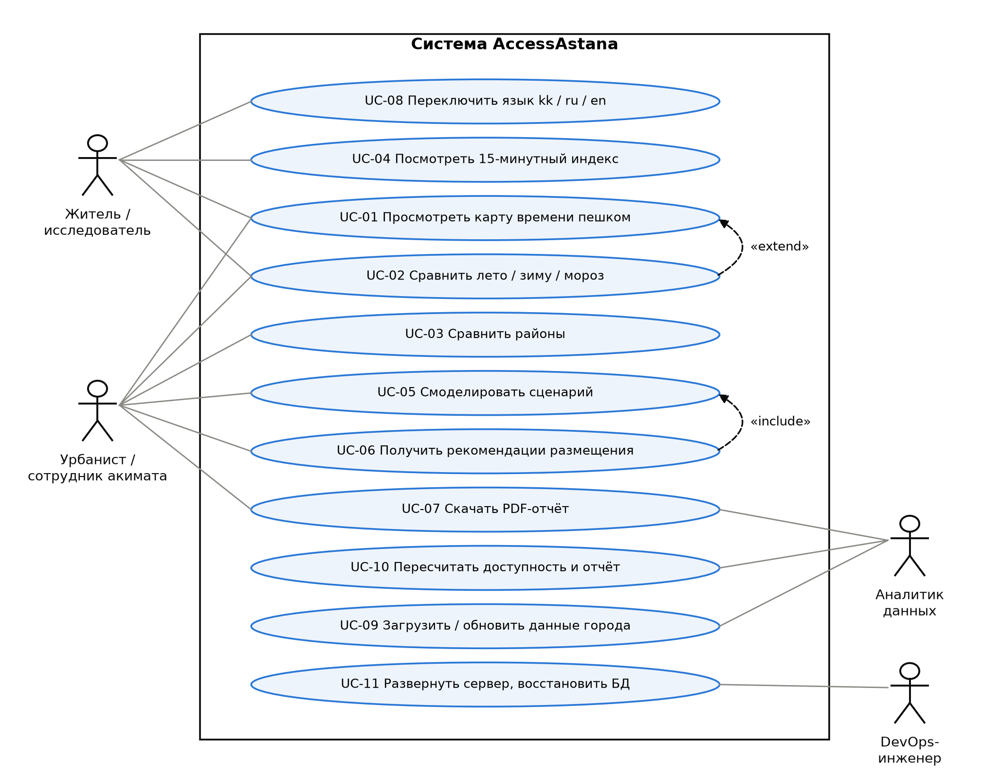

## 2.5. Управление изменениями требований

Изменения проходили цепочку «запрос → анализ влияния → решение → изменение в
отдельной ветке → обновление спецификации» и записаны в журнал изменений (CR):

Таблица: Журнал изменений требований

| № | Изменение | Причина | Влияние |
|---|---|---|---|
| CR-01 | Порог 0,5 га только для `leisure=garden` | После фильтра парков стало 73 вместо 179: отсеялись скверы | Пересчёт POI |
| CR-02 | Исключить сравнение OSM с реестрами | Нет открытого реестра с координатами | Новизна сокращена до двух пунктов, миграция 0002 |
| CR-03 | Коэффициенты скорости из журнальной статьи [10] | Расхождение со слайдами конференции | Скорости 1,235 и 1,106 м/с, пересчёт |
| CR-04 | Анализ чувствительности порога 10 мин | Порог — допущение | Новая таблица отчёта |

# 3. МЕТОДОЛОГИЯ РАЗРАБОТКИ И УПРАВЛЕНИЕ ПРОЕКТОМ

## 3.1. Жизненный цикл и выбор методологии

Таблица: Сравнение методологий для контекста проекта

| Критерий | Waterfall | Scrum | Kanban |
|---|---|---|---|
| Неопределённость требований | плохо: требования фиксируются в начале | хорошо: пересмотр каждый спринт | хорошо: непрерывно |
| Данные с неизвестным качеством (фаза 0 показала пробелы) | риск позднего обнаружения | спринт-исследование, затем корректировка | возможно, но без ритма |
| Учебный семестр с аттестациями | соответствует контрольным точкам | спринты совпадают с контрольными точками | нет естественных контрольных точек |
| Команда 3–4 человека | — | роли Scrum распределяются естественно | меньше ролей |
| Отчётность (velocity, burndown) | — | встроена | lead time / cycle time |

Выбрана гибридная схема **Scrum** с короткими спринтами, соответствующими фазам
0–9 технического задания (data spike → каркас → загрузчики → … → деплой). После
каждой фазы проводился обзор (review) и принималось решение о продолжении, что
соответствует ценностям Agile [28] и Scrum Guide [27]. Фаза 0 сыграла роль
исследовательского спайка и выявила пробелы данных, после чего требования были
скорректированы (раздел 2.5).

## 3.2. Роли и инструменты

Таблица: Роли в команде

| Роль | Зона ответственности | Участник |
|---|---|---|
| Project Manager / Scrum Master | план, риски, отчётность, бюджет | [ЗАПОЛНИТЬ: ФИО] |
| Business Analyst | требования, данные, источники | [ЗАПОЛНИТЬ: ФИО] |
| Developer | бэкенд, анализ, фронтенд | [ЗАПОЛНИТЬ: ФИО] |
| Tester / DevOps | тесты, CI/CD, развёртывание | [ЗАПОЛНИТЬ: ФИО] |

Задачи ведутся в JIRA: эпики соответствуют фазам, истории — US-01…US-12, задачи —
техническим работам. [ЗАПОЛНИТЬ: ссылка на доску JIRA, скриншот доски,
распределение задач по участникам.]

## 3.3. Git-флоу и код-ревью

Принята стратегия Feature Branching: защищённая ветка `main`, ветки `feature/*`,
слияние только через Pull Request с зелёным CI и ревью от другого участника.
Сообщения коммитов следуют Conventional Commits (`feat:`, `fix:`, `docs:`, `chore:`).
Фактическое состояние: локальный репозиторий создан 16.11.2026 (базовый коммит
`e81e3f1`), работа по подготовке к защите велась в ветке `feature/final-defence`.
[ЗАПОЛНИТЬ: ссылка на репозиторий GitHub, PR с ревью, скриншот прогона CI.]

## 3.4. Управление рисками

Реестр рисков (`docs/risks.md`) содержит 15 рисков с оценкой «вероятность ×
влияние» по шкале 1–5. Наиболее значимые риски приведены в таблице.

Таблица: Ключевые риски проекта

| ID | Риск | В × Вл | Мера | Статус |
|---|---|---|---|---|
| R-06 | Отсутствие заявления об использовании ИИ | 5 × 5 = 25 | `docs/AI_USAGE.md`, приложение А | смягчён |
| R-02 | Население Kontur занижено (53%) | 5 × 4 = 20 | калибровка к БНС | смягчён |
| R-03 | Неполнота OSM по детсадам и поликлиникам | 4 × 4 = 16 | оговорка в результатах | открыт |
| R-04 | Оспаривание допущений модели | 4 × 4 = 16 | проверенные источники, анализ чувствительности | смягчён |
| R-01 | Нет открытого реестра объектов | 5 × 3 = 15 | функционал исключён (CR-02) | реализовался |
| R-07 | Исчезновение датированного файла Geofabrik | 4 × 3 = 12 | архив и чек-суммы | открыт |

## 3.5. Метрики процесса

Метрики velocity, lead time, cycle time и sprint burndown рассчитываются по
данным JIRA. [ЗАПОЛНИТЬ: velocity по спринтам (story points), график burndown,
среднее lead time и cycle time — экспорт из JIRA. Без данных команды метрики не
приводятся, чтобы не фальсифицировать их.]

## 3.6. Пример управления изменением: исключение полноты OSM

Запрос CR-02 возник, когда официальные реестры объектов найти не удалось:
- страница egov.kz со списком школ загружает таблицу из внутреннего API, и её
  извлечение было бы скрапингом, что запрещено ТЗ;
- API data.egov.kz требует персонального ключа eGov;
- коммерческие каталоги не допускают такого использования.

Анализ влияния затронул загрузчик, геокодирование, сопоставление, эндпоинт,
вкладку UI и формулировку новизны. Решение команды — исключить функционал;
реализация — миграция `0002_drop_poi_matches.py` и обновление документации.

# 4. ДАННЫЕ

## 4.1. Источники и лицензии

Таблица: Источники данных

| Источник | Версия | Объём | Лицензия | Использование |
|---|---|---|---|---|
| OpenStreetMap, выгрузка Geofabrik `kazakhstan-261115.osm.pbf` [31] | 15.11.2026, MD5 `f4cd092b…` | 226 МБ | ODbL 1.0 [33] | граница, районы, сеть, объекты |
| Kontur Population, Kazakhstan [20] | 01.11.2023, H3 r8 | 15 МБ (gz) | CC BY 4.0 | население |
| Open-Meteo Historical Weather API [22] (ERA5 [21]) | 2015–2024, точка 51,142° N, 71,418° E | 3 653 дня | CC BY 4.0 | сезонные профили |
| Бюро национальной статистики [32] | 01.01.2025 | 1 число | официальная статистика | калибровка населения |

## 4.2. Предобработка

1. **Граница и районы.** Отношение OSM 3087155 (`admin_level=4`, 800,3 км²),
   6 районов (`admin_level=6`): Алматы, Байқоңыр, Есіл, Нұра, Сарайшық, Сарыарқа.
2. **Пешеходная сеть.** Из .pbf отбираются пешеходные пути (исключены
   magistral/motorway, `foot=no`, `access=private`) в буфере 1 км от границы и
   записываются в OSM XML. OSMnx [18] упрощает топологию и оставляет наибольшую
   связную компоненту: 56 266 узлов, 84 265 рёбер, 5 930 км.
3. **Объекты.** Правила тегов задаются в `config/categories.yaml`. Объекты
   одной категории в пределах 20–50 м объединяются (дедупликация: узел и полигон
   одного объекта). Для садов `leisure=garden` действует минимальная площадь
   0,5 га, а для парков пунктами назначения служат точки на границе через
   каждые 100 м.

Таблица: Объекты OSM после предобработки

| Категория | Объектов |
|---|---:|
| Остановки общественного транспорта | 1 103 |
| Продуктовые магазины | 621 |
| Аптеки | 181 |
| Школы | 160 |
| Детские сады | 131 |
| Парки | 131 |
| Поликлиники | 117 |

4. **Население.** Город покрывается ячейками H3 r8, центр которых лежит внутри
   границы (903 ячейки; 344 из них отсутствуют в Kontur и имеют население 0).
   Ячейка относится к району, содержащему её центроид. Калибровка — формула (1).
5. **Климат.** По суточным данным вычисляется индекс охлаждения ветром (формула
   (6)), и дни декабря–февраля классифицируются по профилям.

## 4.3. Ограничения данных

- Kontur — модель, а не перепись. Единый коэффициент калибровки не учитывает
  неравномерный рост новых районов после 2023 г. (районных итогов БНС в открытом
  доступе найти не удалось).
- Полнота точечных объектов OSM не проверена (раздел 4.5).
- Реанализ сглаживает городские микроусловия; уборка снега на тротуарах не
  наблюдается.
- Скорости ходьбы перенесены из норвежских наблюдений [10].

## 4.4. Атрибуции

Атрибуции «© OpenStreetMap contributors (ODbL)», «Kontur Population (CC BY 4.0)»
и «Weather data by Open-Meteo.com (CC BY 4.0)» показываются в интерфейсе
(контрол карты и подвал), в PDF-отчёте, на рисунках и в ответе API `/cities`.

## 4.5. Почему не проверена полнота OSM

Сравнение OSM с официальными реестрами требует машиночитаемых списков объектов
с координатами или адресами. Найденные источники либо не машиночитаемы без
скрапинга, либо требуют персонального ключа (раздел 3.6). Поэтому результаты
следует читать как доступность объектов, отражённых в OSM. Там, где OSM неполон
(по данным фазы 0 это вероятно для детских садов и поликлиник), фактическая
доступность может быть выше.

# 5. АРХИТЕКТУРА И ПРОЕКТНЫЕ РЕШЕНИЯ

## 5.1. Архитектурный стиль

Выбран **модульный монолит**: один репозиторий, один Python-пакет со строго
однонаправленными зависимостями модулей, отдельное SPA и PostgreSQL/PostGIS.

Таблица: Сравнение архитектурных стилей

| Критерий | Модульный монолит (выбран) | Микросервисы | Event-driven |
|---|---|---|---|
| Команда 3–4 чел., один семестр | один деплой, простая отладка | CI/CD и контракты на каждый сервис | нужен брокер и учёт согласованности в конечном счёте |
| Нагрузка | тяжёлый офлайн-расчёт + лёгкий API на чтение | раздельное масштабирование не требуется | данные меняются редко |
| Инфраструктура | один EC2 | несколько сервисов, шлюз | дополнительный контейнер брокера |

## 5.2. Компоненты и развёртывание

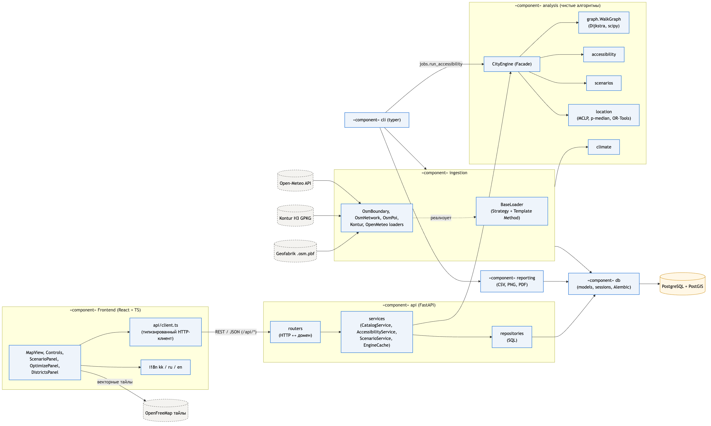

Модули: `ingestion` (загрузка данных) → `db` (модель данных) ← `analysis`
(чистые алгоритмы без доступа к БД) ← `api` (HTTP) и `reporting` (отчёты).
Офлайн-пайплайн выполняется на ноутбуке. Сервер получает готовую базу через
`pg_dump`/`pg_restore` и обслуживает предрасчитанные результаты, считая на лету
только сценарии и оптимизацию.

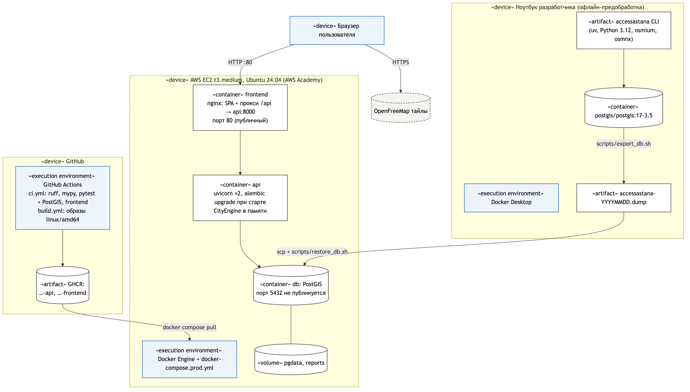

## 5.3. Модель данных

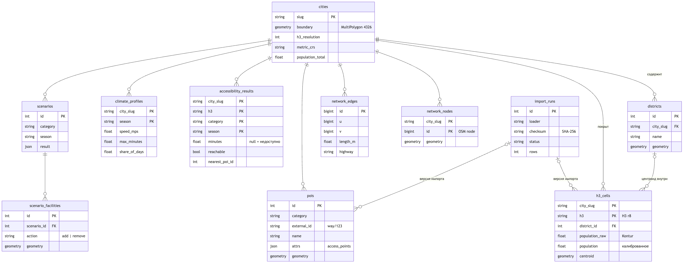

Таблицы: `cities`, `districts`, `h3_cells`, `network_nodes`, `network_edges`, `pois`,
`accessibility_results`, `climate_profiles`, `scenarios`, `scenario_facilities`,
`import_runs`. Миграции Alembic: `0001_initial_schema`, `0002_drop_poi_matches`.
Индексы H3 хранятся как текст и вычисляются в Python, потому что расширение h3-pg в
официальном образе PostGIS отсутствует.

## 5.4. Паттерны проектирования

Таблица: Применённые паттерны

| Паттерн | Где | Зачем |
|---|---|---|
| Strategy | загрузчики `ingestion/*Loader` за `BaseLoader`; выбор по имени в CLI | новый источник данных — один класс |
| Template Method | `BaseLoader.run()` | единый алгоритм: контрольная сумма → пропуск → извлечение → замена в одной транзакции → журнал |
| Repository | `db/repositories.py`, `api/repositories` | SQL изолирован от бизнес-логики |
| Service Layer | `api/services` | валидация и оркестрация вне HTTP |
| Facade | `analysis/engine.py:CityEngine` | один объект для графа, ячеек, сценариев и оптимизации |
| Dependency Injection, Application Factory | `api/deps.py`, `create_app()` | подмена БД и сборщика отчётов в тестах |
| Simple Factory (реестр) | `ingestion.available_loaders()` | имя → класс загрузчика |
| Единственный экземпляр (Singleton intent) | `get_settings()`, `get_engine()`, `EngineCache` | один граф города на процесс |

Классический серверный MVC не применяется: сервер не рендерит представления, его
роль выполняет пара «SPA + JSON API». На фронтенде состояние хранится в React
Context + `useReducer` (однонаправленный поток данных с подпиской компонентов).

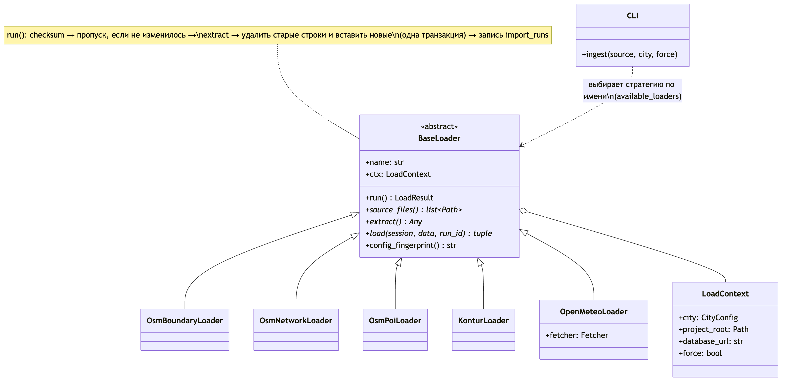

## 5.5. Ключевые технические решения

- **scipy вместо pandana**: у pandana нет готовых сборок для Python 3.12 на arm64.
  Мультиисточниковый алгоритм Дейкстры с виртуальными узлами (раздел 6.2)
  решает задачу ближайшего объекта для всех ячеек за один проход.
- **OSMnx через OSM XML**: OSMnx не читает .pbf, а обращение к Overpass API
  сделало бы результат зависимым от живого сервиса и даты запуска.
- **OR-Tools (CBC) вместо PuLP**: PuLP 4.x не поставляет CBC и изменил API.
- **Сезоны как масштабирование**: профили меняют скорость и порог, но не сеть,
  поэтому одного расчёта расстояний достаточно для всех сезонов.

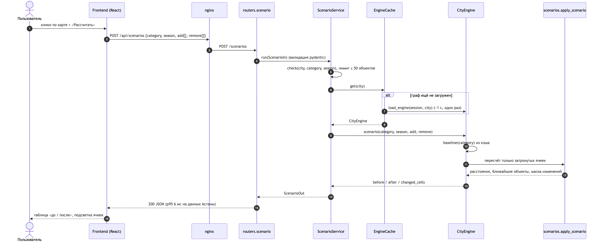

## 5.6. Интерфейс пользователя

Перед реализацией интерфейса подготовлены low-fidelity wireframes
(рисунки 7–8); реализованный интерфейс показан в разделе 7 и приложении Г.

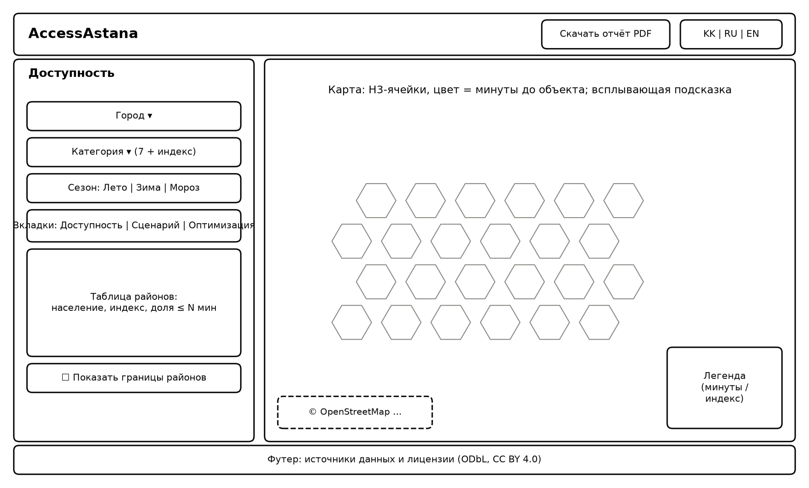

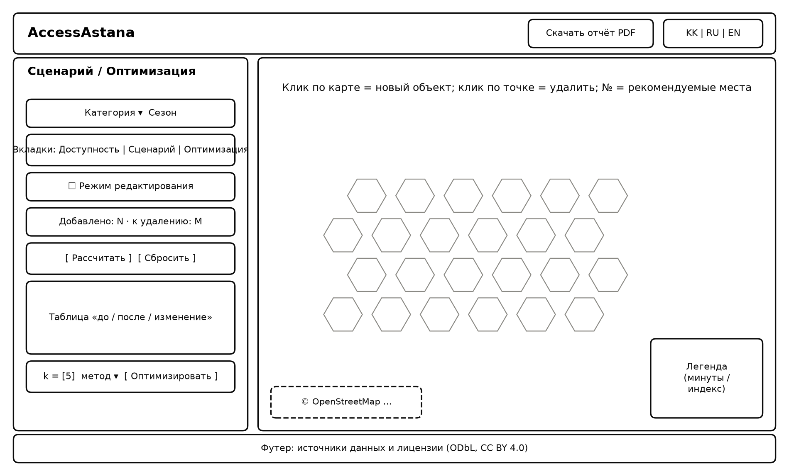

# 6. МЕТОДЫ АНАЛИЗА

## 6.1. Калибровка населения

Пусть p_i — население ячейки i по Kontur, P_БНС — официальная численность города.
Калиброванное население:

```formula
p̂_i = p_i · k,   k = P_БНС / Σ_i p_i = 1 528 887 / 814 833 = 1,8763
```

При наличии районных итогов коэффициент вычисляется для каждого района d:
k_d = P_d / Σ_{i∈d} p_i.

## 6.2. Сетевая пешеходная доступность

Граф G = (V, E) неориентированный, веса рёбер — длины в метрах. Центроид ячейки c_i
привязывается к ближайшему узлу v(c_i) на расстоянии s_i, объект j — к узлу v(j) на
расстоянии s_j. Расстояние до ближайшего объекта:

```formula
D_i = min_j [ s_i + d_G(v(c_i), v(j)) + s_j ],   D_i = ∞, если s_i > 600 м или D_i > 6 000 м
```

Задача решается одним запуском алгоритма Дейкстры: к графу добавляется
виртуальный узел u_j на каждый объект с ориентированным ребром u_j → v(j) веса s_j,
и поиск ведётся одновременно из всех u_j с отбором минимума (`min_only`). Время
в минутах для сезонного профиля с скоростью v_s:

```formula
t_{i,s} = D_i / (60 · v_s)
```

## 6.3. Показатели

Доля населения в пределах порога T и составной 15-минутный индекс ячейки по
K = 7 категориям с весами w_k (по умолчанию равными):

```formula
S(T) = Σ_i p̂_i · [t_i ≤ T] / Σ_i p̂_i
I_i = Σ_k w_k · [t_{i,k} ≤ T_s] / Σ_k w_k
```

Индекс района — средневзвешенный по населению: I_d = Σ_{i∈d} p̂_i I_i / Σ_{i∈d} p̂_i.

## 6.4. Сезонные профили

Таблица: Сезонные профили

| Профиль | Скорость, м/с | Обоснование | Порог T_s, мин | Доля дней дек.–фев. |
|---|---:|---|---:|---:|
| Лето | 1,33 | допущение: между проектным значением 1,22 [12] и наблюдаемыми средними ≈ 1,5 [10] | 15 | — |
| Зима (типичная) | 1,235 | 1,33 · 1,403/1,511 (плотный снег [10]) | 15 | 72,2% |
| Сильный мороз | 1,106 | 1,33 · 1,257/1,511 (чистый лёд [10]) | 10 | 27,8% |

День относится к профилю «сильный мороз», если индекс охлаждения ветром,
рассчитанный по минимальной суточной температуре T (°C) и средней скорости ветра
V (км/ч) на 10 м, не выше −28 [13, 14]:

```formula
WCI = 13,12 + 0,6215·T − 11,37·V^0,16 + 0,3965·T·V^0,16   (при T ≤ 10 °C, V ≥ 4,8 км/ч)
```

Ожидаемый зимний день — смесь профилей с весами, равными долям дней:

```formula
S_зима = (1 − q)·S_типичная + q·S_мороз,   q = 251 / 903 = 0,278
```

Порог 10 мин — допущение команды (нижняя граница окна 10–30 мин [13]). Поэтому
проверяется чувствительность результата к значениям 8, 10 и 12 мин.

## 6.5. Размещение объектов

Обозначения: i — ячейки спроса с весом w_i = p̂_i; j — кандидаты (центроиды
населённых ячеек); d_ij — время пешком; e_i — время до ближайшего существующего
объекта; y_j ∈ {0,1} — открыть объект в j; k — число новых объектов.

**Максимальное покрытие** [15] (только для непокрытых ячеек, e_i > T):

```formula
max Σ_i w_i u_i,   u_i ≤ Σ_{j: d_ij ≤ T} y_j,   Σ_j y_j = k,   0 ≤ u_i ≤ 1
```

**p-медиана с существующими объектами** [16, 17]:

```formula
min Σ_i w_i (e_i z_i + Σ_j d_ij x_ij),   z_i + Σ_j x_ij = 1,   x_ij ≤ y_j,   Σ_j y_j = k
```

Генерируются только пары с d_ij < e_i: назначение на более дальний новый объект
никогда не улучшает целевую функцию. Модель получается разреженной. Недостижимые e_i
ограничиваются 60 мин. Решатель — CBC в OR-Tools [24].

## 6.6. Сценарии «что если»

При удалении объектов пересчитываются только ячейки, ближайший объект которых
удалён. При добавлении выполняется один поиск из новых объектов с отсечкой и
поэлементным минимумом с текущими расстояниями. Оба правила точны: результат
совпадает с полным пересчётом, что проверяется тестом
`test_incremental_scenario_equals_full_recompute`.

# 7. РЕАЛИЗАЦИЯ

Раздел оформлен по формату отчёта о практических работах силлабуса: задача,
методы, модель, функции, команды с комментариями, результат.

## 7.1. Загрузка данных (ingestion)

**Задача:** воспроизводимо загрузить OSM, Kontur и Open-Meteo в PostGIS.
**Методы:** Strategy и Template Method, SHA-256 входных файлов и конфигурации.
**Модель:** `BaseLoader.run()`: контрольная сумма → пропуск, если не изменилось →
`extract()` → удаление старых строк и вставка новых в одной транзакции → запись
в `import_runs`.
**Основные функции:** `read_admin_areas`, `write_walk_xml`, `graph_tables`,
`read_osm_pois`, `dedupe_points`, `boundary_samples`, `cover_polygon`,
`calibrate`, `classify_days`.

```bash
uv sync --extra ingest                                   # зависимости, включая osmium и osmnx
uv run accessastana db-upgrade                           # миграции Alembic
uv run --extra ingest accessastana ingest all --city astana   # 5 загрузчиков
uv run --extra ingest accessastana ingest population     # повторно: «skipped (unchanged)»
```

**Результат:** граница (7 строк), сеть (140 531 строка), объекты (2 444),
ячейки (903), климат (3 профиля) — таблица версий в `docs/results-astana.md`.

## 7.2. Ядро анализа (analysis)

**Задача:** рассчитать доступность, показатели, сценарии и оптимизацию.
**Методы:** мультиисточниковый алгоритм Дейкстры (scipy.sparse.csgraph [23]),
ЦЛП (OR-Tools [24]).
**Основные функции:** `WalkGraph.from_tables`, `WalkGraph.multi_source`,
`nearest_facility`, `to_minutes`, `share_within`, `composite_index`,
`summarize_groups`, `threshold_sensitivity`, `apply_scenario`, `maximal_covering`,
`p_median`, `CityEngine`.

```bash
uv run accessastana analyze all --city astana   # 7 категорий × 3 сезона, ≈ 1 с
uv run accessastana report --city astana        # reports/astana/*.csv, *.png, report.pdf
```

## 7.3. REST API

**Задача:** отдавать предрасчитанные слои и выполнять сценарии и оптимизацию.
**Модель:** routers → services → repositories, `EngineCache` хранит граф в памяти.
Описание эндпоинтов — приложение В и `docs/api.md`.

```bash
uv run uvicorn accessastana.api.main:app --port 8000       # API и Swagger UI на /docs
curl "http://localhost:8000/accessibility?city=astana&category=school&season=winter"
```

## 7.4. Веб-интерфейс

**Задача:** карта H3 с выбором категории и сезона, таблица районов, сценарии,
оптимизация, три языка.
**Технологии:** React 19, TypeScript, Vite, MapLibre GL, deck.gl (H3HexagonLayer),
подложка OpenFreeMap.

```bash
cd frontend && npm install && npm run dev       # http://localhost:5173
docker compose up -d --build                    # весь стек: http://localhost:8080
```


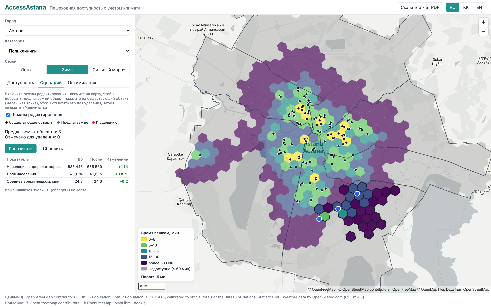

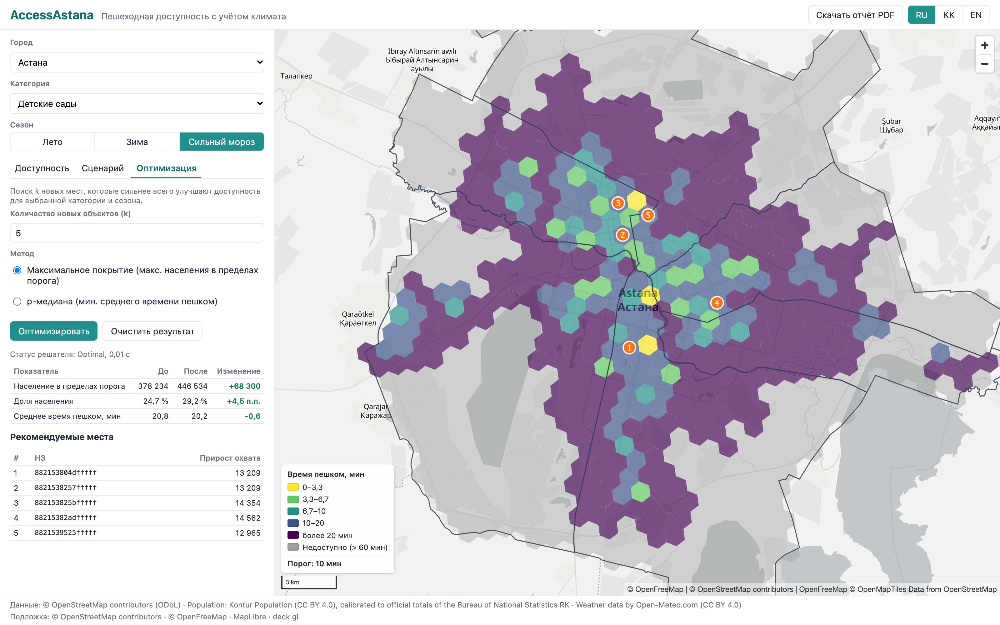

# 8. ТЕСТИРОВАНИЕ И ОБЕСПЕЧЕНИЕ КАЧЕСТВА

## 8.1. Стратегия

Таблица: Уровни тестирования

| Уровень | Что проверяется | Файлы | Количество |
|---|---|---|---:|
| Модульные (unit) | алгоритмы на синтетических графах с известными кратчайшими путями, калибровка, климат, оптимизация на игрушечных задачах | `tests/unit/` | 29 |
| Интеграционные | загрузчики → расчёт → API на тестовой PostGIS (синтетический город) | `tests/integration/` | 10 |
| Приёмочные | критерии приёмки US-01…US-11 через HTTP API | `tests/acceptance/` | 10 |
| Системные (smoke) | работающий стек через nginx: SPA, health, слои, задержка, PDF | `tests/system/` | 4 |
| Фронтенд | цветовая шкала, полнота словарей, формат чисел | `frontend/src/**/*.test.ts` | 15 |

Тесты не скачивают данные. Интеграционные тесты строят синтетический город
(сетка улиц 9 × 9 в OSM XML, GeoPackage населения, подделанный ответ Open-Meteo) и
запускают настоящие загрузчики.

## 8.2. Результаты

Таблица: Результаты автоматических проверок (16.11.2026)

| Проверка | Результат |
|---|---|
| pytest (unit + integration + acceptance) | 49 passed, 4 skipped (системные без адреса стенда) |
| Системные тесты против стенда (`ACCESSASTANA_SMOKE_URL=http://localhost:8080`) | 4 passed |
| Покрытие `analysis` + `api` | 98% (741 оператор, 18 не покрыто) |
| Покрытие всего пакета | 95% (1 827 операторов, 96 не покрыто) |
| ruff check, ruff format, mypy (`disallow_untyped_defs`) | 0 ошибок |
| ESLint + `tsc --noEmit`, vitest | 0 ошибок, 15 passed |
| Запуск «с нуля» по README на чистой копии | успешно, пайплайн 363 с |
| npm audit | 1 уязвимость уровня moderate (fflate, транзитивно через deck.gl) |

## 8.3. Найденные и исправленные дефекты

Таблица: Дефекты, выявленные при разработке и аудите

| Дефект | Как выявлен | Исправление |
|---|---|---|
| Порог 0,5 га отсекал скверы (парков 73 вместо 179) | сверка с фазой 0 | правило только для садов |
| `pivot_table(dropna=False)` строил декартово произведение и обнулял индекс | визуальная проверка карт | pivot только по `h3` |
| `pg_restore --clean` удалял схему `public`, от которой зависит PostGIS | тест восстановления | исключение из оглавления дампа |
| Таблица районов обрезалась при ширине панели 380 px | автоматическая съёмка экрана | панель 440 px |
| Казахский интерфейс выводил числа в английском формате (нет ICU-данных `kk-KZ`) | автоматическая съёмка экрана | откат на `ru-RU` и тест |
| Неточные параметры скорости (взяты со слайдов конференции) | проверка источников | значения из статьи [10], пересчёт |

## 8.4. Статический анализ и код-ревью

ruff (pycodestyle, pyflakes, isort, bugbear, pyupgrade, naming), mypy для ядра,
ESLint и TypeScript в строгом режиме. В CI (`.github/workflows/ci.yml`) те же
проверки выполняются на каждый Pull Request. [ЗАПОЛНИТЬ: результаты код-ревью
через PR — ссылки и примеры замечаний.]

# 9. DEVOPS И РАЗВЁРТЫВАНИЕ

- **Окружение разработки:** uv (Python 3.12), Docker Compose (PostGIS, API,
  фронтенд), `.env` по шаблону `.env.example`.
- **Контейнеры:** `docker/api.Dockerfile` (образ 2,15 ГБ: geopandas, OR-Tools, matplotlib),
  `docker/ingest.Dockerfile` (офлайн-пайплайн), `frontend/Dockerfile`
  (сборка Vite → nginx, 79,9 МБ).
- **CI/CD:** `ci.yml` — ruff, mypy, pytest с сервисом PostGIS, порог покрытия 70%,
  сборка фронтенда; `build.yml` — образы linux/amd64 в GHCR при слиянии в `main`;
  Dependabot для uv, npm, GitHub Actions и Docker.
- **Продакшен:** `docker-compose.prod.yml` на одном EC2 t3.medium (AWS Academy). Публичен
  только порт 80; данные переносятся дампом БД (7,4 МБ) через
  `scripts/export_db.sh` и `scripts/restore_db.sh`. Повторное восстановление
  проверено дважды.
- **Документы:** `docs/deployment-aws.md`, `docs/system-manual.md`.

[ЗАПОЛНИТЬ: скриншоты прогона GitHub Actions и развёрнутого EC2 (AWS Academy),
публичный адрес демо-стенда.]

# 10. РЕЗУЛЬТАТЫ

Все числа раздела получены командой `accessastana report` и находятся в
`reports/astana/` и `docs/results-astana.md`.

## 10.1. Доступность по категориям и сезонам

Таблица: Доля жителей в пределах допустимого времени пешком

| Категория | Лето (15 мин) | Зима (15 мин) | Сильный мороз (10 мин) | Ожидаемый зимний день | Потеря, п.п. |
|---|---:|---:|---:|---:|---:|
| Остановки | 82,2% | 81,1% | 64,9% | 76,6% | −5,6 |
| Продуктовые магазины | 73,7% | 70,3% | 48,4% | 64,2% | −9,5 |
| Школы | 60,7% | 55,3% | 29,4% | 48,1% | −12,6 |
| Аптеки | 55,0% | 50,9% | 32,2% | 45,7% | −9,3 |
| Детские сады | 54,5% | 50,8% | 24,7% | 43,5% | −10,9 |
| Парки | 48,6% | 43,2% | 27,7% | 38,9% | −9,7 |
| Поликлиники | 45,2% | 41,6% | 20,8% | 35,8% | −9,4 |


Снижение скорости на снегу при сохранении порога 15 мин уменьшает доли на
1,1–5,4 п.п. Основная потеря возникает в дни сильного мороза, когда порог
сокращается до 10 мин: от 17,3 п.п. для остановок до 31,3 п.п. для школ
относительно лета. В ожидаемый зимний день потери составляют 5,6–12,6 п.п.

## 10.2. Районы

Таблица: 15-минутный индекс по районам

| Район | Население (калибр.) | Лето | Зима | Мороз |
|---|---:|---:|---:|---:|
| Сарыарқа | 339 439 | 0,74 | 0,71 | 0,47 |
| Есіл | 247 693 | 0,70 | 0,68 | 0,45 |
| Алматы | 206 759 | 0,67 | 0,60 | 0,37 |
| Нұра | 268 721 | 0,58 | 0,50 | 0,30 |
| Сарайшық | 165 763 | 0,44 | 0,41 | 0,18 |
| Байқоңыр | 300 455 | 0,43 | 0,41 | 0,28 |


Наилучшую доступность имеет центральный район Сарыарқа, наихудшую — Байқоңыр и
Сарайшық. В сильный мороз индекс Сарайшық падает до 0,18. Зона высокой
доступности сжимается к ядру города.

## 10.3. Чувствительность к порогу в сильный мороз

Таблица: Доля жителей в пределах порога в сильный мороз при разных допущениях

| Категория | ≤ 8 мин | ≤ 10 мин (принято) | ≤ 12 мин | Разброс, п.п. |
|---|---:|---:|---:|---:|
| Остановки | 53,0% | 64,9% | 72,8% | 19,9 |
| Продуктовые магазины | 38,4% | 48,4% | 59,1% | 20,7 |
| Аптеки | 21,9% | 32,2% | 36,2% | 14,2 |
| Школы | 21,7% | 29,4% | 37,3% | 15,7 |
| Парки | 22,5% | 27,7% | 33,1% | 10,6 |
| Детские сады | 14,2% | 24,7% | 34,9% | 20,7 |
| Поликлиники | 14,4% | 20,8% | 30,5% | 16,1 |

Результат для сильного мороза чувствителен к допущению: изменение порога на
±2 мин меняет доли на 10,6–20,7 п.п. Качественный вывод при этом устойчив:
даже при пороге 12 мин доли в сильный мороз ниже, чем в типичный зимний день
(например, для поликлиник 30,5% против 41,6%).

## 10.4. Рекомендации по размещению

Таблица: Эффект пяти новых объектов (k = 5)

| Категория | Сезон | Метод | Доля до → после | Прирост, п.п. | Прирост жителей | Ср. время, мин* |
|---|---|---|---|---:|---:|---|
| Поликлиники | лето | макс. покрытие | 45,2% → 52,1% | +6,92 | 105 860 | 23,06 → 20,08 |
| Поликлиники | лето | p-медиана | 45,2% → 48,8% | +3,68 | 56 196 | 23,06 → 18,83 |
| Поликлиники | мороз | макс. покрытие | 20,8% → 25,9% | +5,10 | 77 976 | 27,73 → 27,05 |
| Детские сады | мороз | макс. покрытие | 24,7% → 29,2% | +4,47 | 68 300 | 20,82 → 20,23 |
| Школы | мороз | макс. покрытие | 29,4% → 34,3% | +4,94 | 75 479 | 18,38 → 17,49 |

\* Среднее по жителям, для которых объект достижим в пределах 60 мин.
Источник: `docs/final/evidence/optimization_examples.txt`.

Метод максимального покрытия даёт наибольший прирост охвата, p-медиана — наибольшее
сокращение среднего времени. Время решения — 0,004–0,1 с.

## 10.5. Ограничения результатов

1. Полнота объектов OSM не проверена: при неполноте OSM доступность занижена.
2. Единый коэффициент калибровки населения.
3. Перенос норвежских скоростей ходьбы и допущение о пороге 10 мин.
4. Центроид ячейки представляет всю ячейку (≈ 0,74 км²); соединение с сетью
   идёт по прямой.
5. Около 31 тыс. жителей живут в ячейках дальше 600 м от картированной
   пешеходной сети и считаются «недоступными».

# 11. ФИНАНСОВОЕ ОБОСНОВАНИЕ И ФИНАНСОВЫЙ ОБЗОР

**Оговорка.** Проект учебный, и приведённый бюджет — **модельный**. Он
составлен по нормам конкурса грантового финансирования на 2026–2028 гг. [34],
Правил оплаты труда научных работников [35] и Правил возмещения командировочных
расходов [36], чтобы показать навык финансового обоснования. Все формулы —
в `docs/final/budget/budget.xlsx` (формулами) и в скрипте
`docs/final/budget/budget_model.py`. Параметры, которые должна предоставить
команда (данные участников, ставки налогов, ценовые предложения, курсы валют),
выделены и помечены [ЗАПОЛНИТЬ].

## 11.1. Параметры заявки

- Срок — 36 месяцев (январь 2026 — декабрь 2028); лимиты — не более 30 млн тг на
  2026 г., 40 млн тг на 2027 г. и 40 млн тг на 2028 г. [34].
- Вид исследований — прикладные (Квид = 1,15), финансирование грантовое
  (Ктип = 2,0), Сбаз = 190 000 тг [35, п. 6].
- МРП = 4 325 тг (2026 г.); для 2027–2028 гг. то же значение принято как допущение.
- Модельный состав группы: научный руководитель и четыре магистранта-исполнителя,
  занятость каждого 0,5 ставки. Это допущение до получения данных команды.
  [ЗАПОЛНИТЬ: фактический состав, должности по приложению 1, стаж, учёные
  степени, баллы достижений для Кдос, возраст.]

## 11.2. Статья 1. Оплата труда

Должностной оклад и оплата при частичной занятости [35, п. 6, п. 14]:

```formula
ДО = ДС · Кп,   ДС = Сбаз · Кдо,   Кп = Квид · Ктип · Крук · Кдос
П = Г · ДО
```

Контрольный пример из Правил: научный сотрудник (класс 4, стаж 0–1) —
190 000 · 1,02 · 1,15 · 2,0 · 1,0 = 445 740 тг/мес. Модель воспроизводит это
значение по той же формуле.

<!-- include: budget/budget_tables.md -->

Доплата за степень PhD (17 МРП = 73 525 тг/мес) [35, п. 12] включена для
руководителя. [ЗАПОЛНИТЬ: уточнить в бухгалтерии, финансируется ли доплата по
основному месту работы за счёт гранта.] Налоги и обязательные платежи (социальный
налог, социальные отчисления, ОСМС, ОПВР, резерв отпускных) вынесены в
параметры листа «Параметры». [ЗАПОЛНИТЬ: ставки уточнить в бухгалтерии
университета.] ИПН и ОПВ удерживаются из начисленной суммы и сумму статьи не
увеличивают.

## 11.3. Статья 2. Служебные командировки

Командировки рассчитаны по нормам постановления № 256 [36]:
- по Казахстану — суточные 2 МРП в день, проживание в Алматы не более 7 МРП в
  сутки (п. 3), проезд по железной дороге в купейном вагоне;
- за рубеж — суточные и проживание по нормам страны (п. 7), авиабилет эконом-класса,
  курс НБРК на дату перечисления.

Для командировки в Алматы (2 человека, 3 дня, 2 ночи) суточные составляют
12 МРП = 51 900 тг, проживание — 28 МРП = 121 100 тг, итого без билетов
173 000 тг. Суммы зарубежных командировок приведены в валюте и пересчитываются
по курсу. [ЗАПОЛНИТЬ: названия конференций, ценовые предложения перевозчиков,
курсы USD и EUR.]

## 11.4. Статьи 3–5

- **3. Научно-организационное сопровождение:** оргвзносы за три конференции,
  публикация двух статей в открытом доступе.
- **4. Оборудование и ПО:** рабочая станция для обработки данных.
  Программное обеспечение проекта — открытое (Python, PostGIS, OR-Tools, React),
  поэтому лицензионных расходов нет.
- **5. Эксплуатационные расходы:** облачный сервер для демонстрационного стенда
  (EC2 t3.medium или аналог) и архив исходных данных.

Суммы определяются по ценовым предложениям (не менее одного на позицию [34]).
[ЗАПОЛНИТЬ: ценовые предложения.]

## 11.5. Структура бюджета и сравнение с ориентиром

ФОТ без налогов в модели составляет 15 768 705 тг в год, или 52,6% лимита 2026 г.
и 39,4% лимитов 2027–2028 гг. В ориентирной одобренной заявке ННС (8 человек,
83,3 млн тг) доля оплаты труда с налогами — 61,88%, командировок — 15,05%,
научно-организационного сопровождения — 1,53%, оборудования и ПО — 16,53%,
эксплуатационных расходов — 5% [34]. После ввода ставок и цен структура
проекта пересчитывается на листе «Свод» budget.xlsx. Там же проверяется
соблюдение лимитов и требование о доле молодых учёных (в модели — 80% при
требовании не менее 30%).

## 11.6. Финансовый обзор «план — факт»

Таблица: План и факт по статьям расходов

| Статья | План (модель) | Факт | Отклонение | Причина |
|---|---|---|---|---|
| 1. Оплата труда | 47 306 115 тг без налогов (3 года) | [ЗАПОЛНИТЬ] | [ЗАПОЛНИТЬ] | [ЗАПОЛНИТЬ] |
| 2. Командировки | 173 000 тг + зарубежные по курсу | [ЗАПОЛНИТЬ] | [ЗАПОЛНИТЬ] | [ЗАПОЛНИТЬ] |
| 3. Научно-организационное сопровождение | [ЗАПОЛНИТЬ] | [ЗАПОЛНИТЬ] | [ЗАПОЛНИТЬ] | [ЗАПОЛНИТЬ] |
| 4. Оборудование и ПО | [ЗАПОЛНИТЬ] | [ЗАПОЛНИТЬ] | [ЗАПОЛНИТЬ] | [ЗАПОЛНИТЬ] |
| 5. Эксплуатационные расходы | [ЗАПОЛНИТЬ] | [ЗАПОЛНИТЬ] | [ЗАПОЛНИТЬ] | [ЗАПОЛНИТЬ] |

Фактические расходы учебного проекта [ЗАПОЛНИТЬ: например, оплата облака сверх
кредитов AWS Academy, домен; если расходов не было — указать «0» и пояснить, что
использовались бесплатные ресурсы: AWS Academy, открытые данные, открытое ПО].

# 12. POST-MORTEM И LESSONS LEARNED

## 12.1. Ответы команды

Таблица: Вопросы ретроспективы

| Вопрос | Ответ команды |
|---|---|
| Что прошло хорошо? | [ЗАПОЛНИТЬ] |
| Что пошло не так? | [ЗАПОЛНИТЬ] |
| Что улучшить в следующем проекте? | [ЗАПОЛНИТЬ] |
| Как распределялась нагрузка, что мешало? | [ЗАПОЛНИТЬ: по результатам опроса / интервью команды] |

## 12.2. Наблюдения ИИ-ассистента по истории разработки

Наблюдения сделаны ассистентом по ходу сессии разработки и по истории
репозитория. Это не ответы команды.

1. **Ранний data spike окупился.** Фаза 0 до написания кода выявила занижение
   населения на 47% и дубликаты остановок, и требования изменились раньше, чем
   это стало бы дорогой ошибкой.
2. **Риск внешних данных реализовался.** Функционал полноты OSM пришлось
   исключить из-за отсутствия открытого реестра (CR-02). Урок: проверять
   доступность каждого источника в фазе 0, а не только описывать его.
3. **Проверка источников нашла ошибки.** Скорости ходьбы были взяты со слайдов
   конференции, а не из статьи, и формулировка про Кноблауха была неточна.
   Урок: каждое число модели сверять с первоисточником до написания текста.
4. **Визуальная проверка нашла то, что пропустили тесты.** Ошибка pivot,
   обнулявшая индекс, и дефекты UI проявились только на картах и скриншотах.
   Урок: включать в приёмку просмотр ключевых артефактов.
5. **Процесс не был версионирован с начала.** История git начинается
   16.11.2026, поэтому метрики процесса (velocity, PR) за ранний период
   восстановить нельзя. Урок: создавать репозиторий и доску в первый день.
6. **Большая доля работы сделана ИИ-ассистентом**, и это раскрыто в приложении А.
   Команда отвечает за понимание и защиту каждой части.

# ЗАКЛЮЧЕНИЕ

В работе создана воспроизводимая система AccessAstana для оценки
климатически скорректированной пешеходной доступности социальной
инфраструктуры Астаны по открытым данным. Задачи выполнены следующим образом.

1. Исследованы открытые данные; выявлены занижение населения Kontur (53% от
   официального) и неоднородность OSM. Предложена калибровка (k = 1,8763).
2. Сформулированы 15 функциональных и 12 нефункциональных требований,
   12 пользовательских историй с критериями приёмки и 11 вариантов использования.
3. Спроектирован модульный монолит с моделью данных PostGIS/H3; применены
   паттерны Strategy, Template Method, Repository, Service Layer, Facade.
4. Реализован пайплайн (6 мин для Астаны) и расчёт доступности для 7 категорий
   и 3 сезонных профилей; параметры профилей обоснованы проверенными источниками.
5. Реализованы MCLP и p-медиана, а также точные инкрементные сценарии
   (p95 — 0,006 с).
6. Реализованы REST API и трёхъязычный веб-интерфейс.
7. Обеспечено качество: 49 автоматических тестов на Python и 15 на фронтенде,
   покрытие ядра 98%, CI/CD, Docker.
8. Получены результаты: в сильный мороз доля жителей в пределах допустимого
   времени до поликлиники падает с 45,2% летом до 20,8%, до школы — с 60,7% до
   29,4%. Районы Байқоңыр и Сарайшық наименее обеспечены. Пять новых поликлиник
   могут дополнительно охватить до 105 860 жителей.
9. Подготовлены модельный бюджет по нормам грантового финансирования, финансовый
   обзор и ретроспектива (часть данных — [ЗАПОЛНИТЬ] командой).

**Направления развития:**
- проверка полноты OSM по официальным реестрам, полученным по запросу;
- районная калибровка населения по данным БНС;
- полевые замеры скорости ходьбы в Астане зимой;
- сезонная сеть (неубираемые пути);
- учёт возрастных групп пешеходов [4];
- добавление других городов Казахстана.

# СПИСОК ИСПОЛЬЗОВАННЫХ ИСТОЧНИКОВ

1. Moreno C., Allam Z., Chabaud D., Gall C., Pratlong F. Introducing the “15-Minute City”: Sustainability, Resilience and Place Identity in Future Post-Pandemic Cities // Smart Cities. – 2021. – Vol. 4, No. 1. – P. 93–111. – DOI: 10.3390/smartcities4010006.
2. Pozoukidou G., Chatziyiannaki Z. 15-Minute City: Decomposing the New Urban Planning Eutopia // Sustainability. – 2021. – Vol. 13, No. 2. – Art. 928. – DOI: 10.3390/su13020928.
3. Logan T. M., Hobbs M. H., Conrow L. C. [et al.] The x-minute city: Measuring the 10, 15, 20-minute city and an evaluation of its use for sustainable urban design // Cities. – 2022. – Vol. 131. – Art. 103924. – DOI: 10.1016/j.cities.2022.103924.
4. Willberg E., Fink C., Toivonen T. The 15-minute city for all? – Measuring individual and temporal variations in walking accessibility // Journal of Transport Geography. – 2023. – Vol. 106. – Art. 103521. – DOI: 10.1016/j.jtrangeo.2022.103521.
5. Hansen W. G. How Accessibility Shapes Land Use // Journal of the American Institute of Planners. – 1959. – Vol. 25, No. 2. – P. 73–76. – DOI: 10.1080/01944365908978307.
6. Geurs K. T., van Wee B. Accessibility evaluation of land-use and transport strategies: review and research directions // Journal of Transport Geography. – 2004. – Vol. 12, No. 2. – P. 127–140. – DOI: 10.1016/j.jtrangeo.2003.10.005.
7. Weiss D. J., Nelson A., Gibson H. S. [et al.] A global map of travel time to cities to assess inequalities in accessibility in 2015 // Nature. – 2018. – Vol. 553, No. 7688. – P. 333–336. – DOI: 10.1038/nature25181.
8. Haklay M. How Good is Volunteered Geographical Information? A Comparative Study of OpenStreetMap and Ordnance Survey Datasets // Environment and Planning B: Planning and Design. – 2010. – Vol. 37, No. 4. – P. 682–703. – DOI: 10.1068/b35097.
9. Barrington-Leigh C., Millard-Ball A. The world’s user-generated road map is more than 80% complete // PLOS ONE. – 2017. – Vol. 12, No. 8. – Art. e0180698. – DOI: 10.1371/journal.pone.0180698.
10. Fossum M., Ryeng E. O. The walking speed of pedestrians on various pavement surface conditions during winter // Transportation Research Part D: Transport and Environment. – 2021. – Vol. 97. – Art. 102934. – DOI: 10.1016/j.trd.2021.102934.
11. Liang S., Leng H., Yuan Q., Wang B., Yuan C. How does weather and climate affect pedestrian walking speed during cool and cold seasons in severely cold areas? // Building and Environment. – 2020. – Vol. 175. – Art. 106811. – DOI: 10.1016/j.buildenv.2020.106811.
12. Knoblauch R. L., Pietrucha M. T., Nitzburg M. Field Studies of Pedestrian Walking Speed and Start-Up Time // Transportation Research Record: Journal of the Transportation Research Board. – 1996. – Vol. 1538, No. 1. – P. 27–38. – DOI: 10.1177/0361198196153800104.
13. Environment and Climate Change Canada. Wind chill and the Wind Chill Index [Электронный ресурс]. – URL: https://www.canada.ca/en/services/environment/weather/severeweather/wind-chill-index.html (дата обращения: 16.11.2026).
14. Osczevski R., Bluestein M. The New Wind Chill Equivalent Temperature Chart // Bulletin of the American Meteorological Society. – 2005. – Vol. 86, No. 10. – P. 1453–1458. – DOI: 10.1175/BAMS-86-10-1453.
15. Church R., ReVelle C. The maximal covering location problem // Papers of the Regional Science Association. – 1974. – Vol. 32, No. 1. – P. 101–118. – DOI: 10.1007/BF01942293.
16. Hakimi S. L. Optimum Locations of Switching Centers and the Absolute Centers and Medians of a Graph // Operations Research. – 1964. – Vol. 12, No. 3. – P. 450–459. – DOI: 10.1287/opre.12.3.450.
17. ReVelle C. S., Swain R. W. Central Facilities Location // Geographical Analysis. – 1970. – Vol. 2, No. 1. – P. 30–42. – DOI: 10.1111/j.1538-4632.1970.tb00142.x.
18. Boeing G. OSMnx: New methods for acquiring, constructing, analyzing, and visualizing complex street networks // Computers, Environment and Urban Systems. – 2017. – Vol. 65. – P. 126–139. – DOI: 10.1016/j.compenvurbsys.2017.05.004.
19. H3: Hexagonal hierarchical geospatial indexing system [Электронный ресурс] : документация. – URL: https://h3geo.org/docs/ (дата обращения: 16.11.2026).
20. Kontur. Kazakhstan: Population Density for 400m H3 Hexagons [Электронный ресурс] : dataset. – Humanitarian Data Exchange (HDX), 2023. – URL: https://data.humdata.org/dataset/kontur-population-kazakhstan (дата обращения: 16.11.2026).
21. Hersbach H., Bell B., Berrisford P. [et al.] The ERA5 global reanalysis // Quarterly Journal of the Royal Meteorological Society. – 2020. – Vol. 146, No. 730. – P. 1999–2049. – DOI: 10.1002/qj.3803.
22. Zippenfenig P. Open-Meteo.com Weather API [Электронный ресурс] : software. – Zenodo, 2024. – DOI: 10.5281/zenodo.7970649. – URL: https://open-meteo.com/ (дата обращения: 16.11.2026).
23. Virtanen P., Gommers R., Oliphant T. E. [et al.] SciPy 1.0: fundamental algorithms for scientific computing in Python // Nature Methods. – 2020. – Vol. 17, No. 3. – P. 261–272. – DOI: 10.1038/s41592-019-0686-2.
24. Perron L., Furnon V. OR-Tools [Электронный ресурс] : software, version 9.15 / Google. – URL: https://developers.google.com/optimization/ (дата обращения: 16.11.2026).
25. Atakhanova Z., Baigaliyeva M. Kazakhstan’s Infrastructure Programs and Urban Sustainability Analysis of Astana // Urban Science. – 2025. – Vol. 9, No. 4. – Art. 100. – DOI: 10.3390/urbansci9040100.
26. Kontsevik G., Gubina A., Tikhevich V., Mityagin S. Environment-framed networks: seasonal reconfiguration of service accessibility in Arctic transport systems // Applied Network Science. – 2026. – Vol. 11, No. 1. – Art. 35. – DOI: 10.1007/s41109-026-00783-6.
27. Schwaber K., Sutherland J. The 2020 Scrum Guide [Электронный ресурс]. – 2020. – URL: https://scrumguides.org/scrum-guide.html (дата обращения: 16.11.2026).
28. Beck K., Beedle M., van Bennekum A. [et al.] Manifesto for Agile Software Development [Электронный ресурс]. – 2001. – URL: https://agilemanifesto.org/ (дата обращения: 16.11.2026).
29. ГОСТ 7.32–2017. Система стандартов по информации, библиотечному и издательскому делу. Отчет о научно-исследовательской работе. Структура и правила оформления : межгосударственный стандарт : введен впервые с 01.07.2018.
30. ГОСТ Р 7.0.100–2018. Библиографическая запись. Библиографическое описание. Общие требования и правила составления : национальный стандарт Российской Федерации : введен 01.07.2019.
31. Geofabrik GmbH. Download OpenStreetMap data for Kazakhstan [Электронный ресурс]. – URL: https://download.geofabrik.de/asia/kazakhstan.html (дата обращения: 16.11.2026).
32. Бюро национальной статистики Агентства по стратегическому планированию и реформам РК. О демографической ситуации за январь–декабрь 2024 года [Электронный ресурс]. – URL: https://stat.gov.kz/ru/news/o-demograficheskoy-situatsii-za-yanvar-dekabr-2024-goda/ (дата обращения: 16.11.2026).
33. OpenStreetMap Foundation. Copyright and License [Электронный ресурс]. – URL: https://www.openstreetmap.org/copyright (дата обращения: 16.11.2026).
34. Конкурс на грантовое финансирование научных исследований на 2026–2028 годы : конкурсная документация / Комитет науки Министерства науки и высшего образования Республики Казахстан. – Астана, 2025. – [НУЖЕН ИСТОЧНИК: URL официальной публикации конкурсной документации].
35. Правила оплаты труда научных работников : утв. приказом и.о. Министра науки и высшего образования РК от 25.12.2024 № 592 (с изм. от 04.09.2026 № 424). – [НУЖЕН ИСТОЧНИК: URL на adilet.zan.kz].
36. Правила возмещения расходов на служебные командировки за счёт бюджетных средств, в том числе в иностранные государства : утв. постановлением Правительства РК от 11.05.2018 № 256 (с изм. от 14.07.2026 № 615). – [НУЖЕН ИСТОЧНИК: URL на adilet.zan.kz].

# ПРИЛОЖЕНИЕ А. Заявление об использовании генеративного ИИ

<!-- include: ../AI_USAGE.md -->

# ПРИЛОЖЕНИЕ Б. Руководство пользователя

<!-- include: ../user-manual.md -->

# ПРИЛОЖЕНИЕ В. Описание API

<!-- include: ../api.md -->

# ПРИЛОЖЕНИЕ Г. Скриншоты

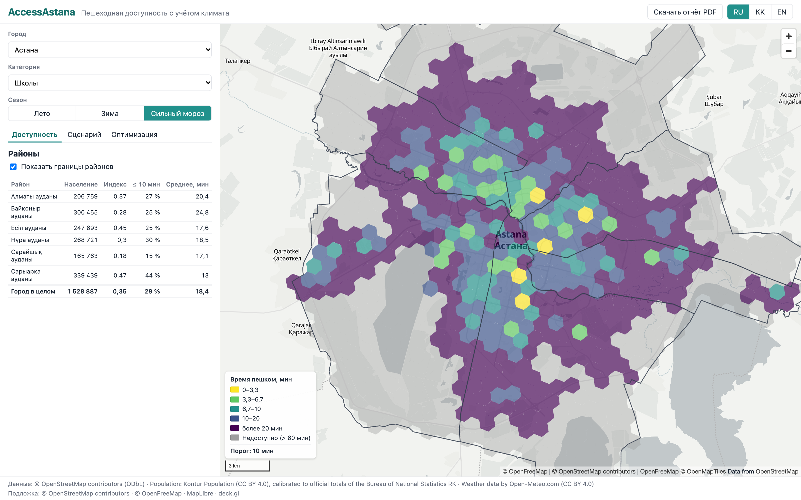

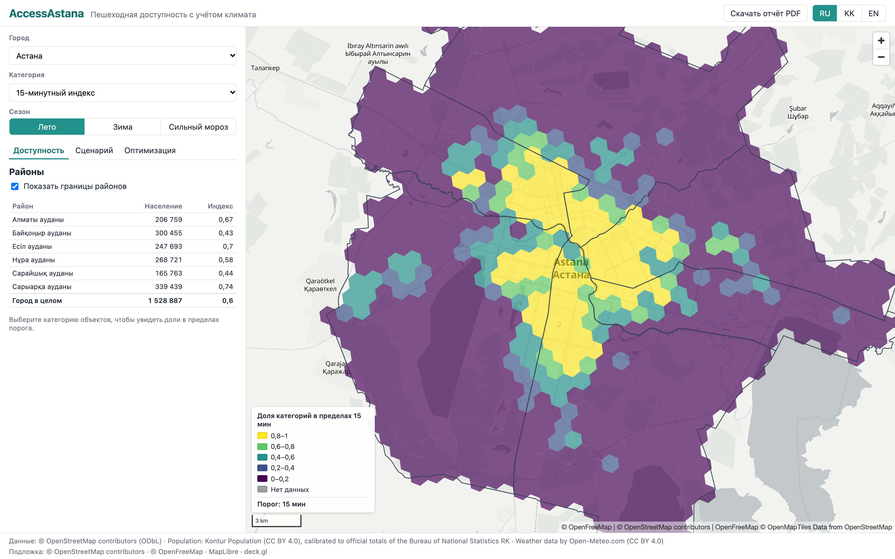


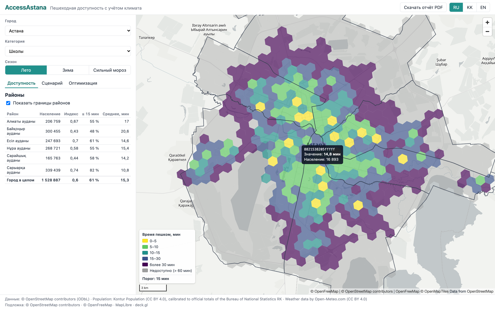

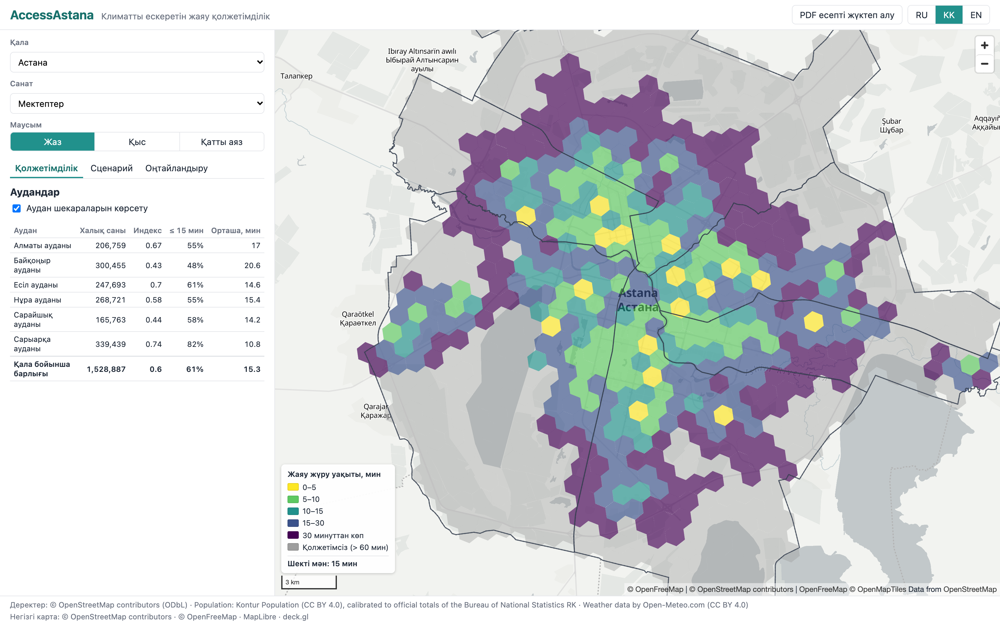

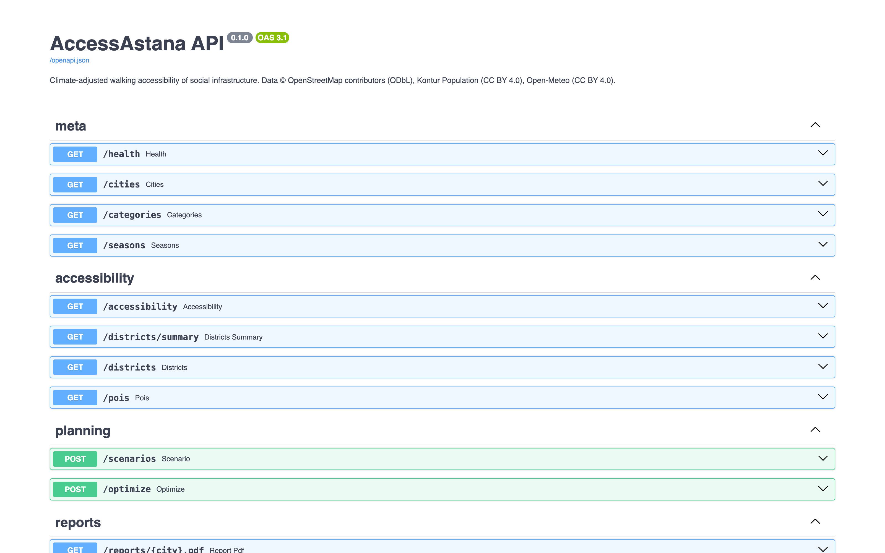

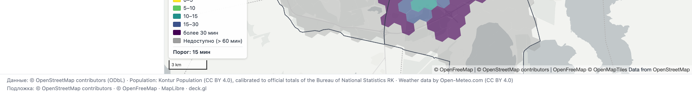

[ЗАПОЛНИТЬ: скриншоты доски JIRA, прогона GitHub Actions, Pull Request с ревью, развёрнутого EC2.]

# ПРИЛОЖЕНИЕ Д. Расчёт бюджета

Полный расчёт с формулами — `docs/final/budget/budget.xlsx`. Листы: «Свод»,
«Параметры», «Кдо», «Оплата труда», «Командировки», «Прочие статьи», «План-факт».
Таблицы Д.1–Д.4 приведены в разделе 11 и генерируются скриптом
`docs/final/budget/budget_model.py`.
