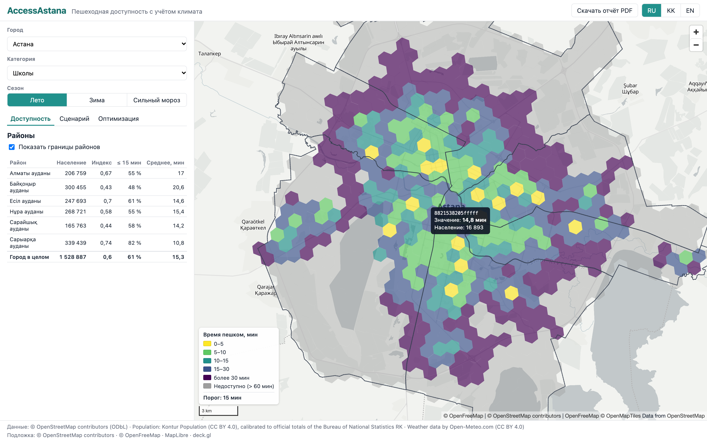
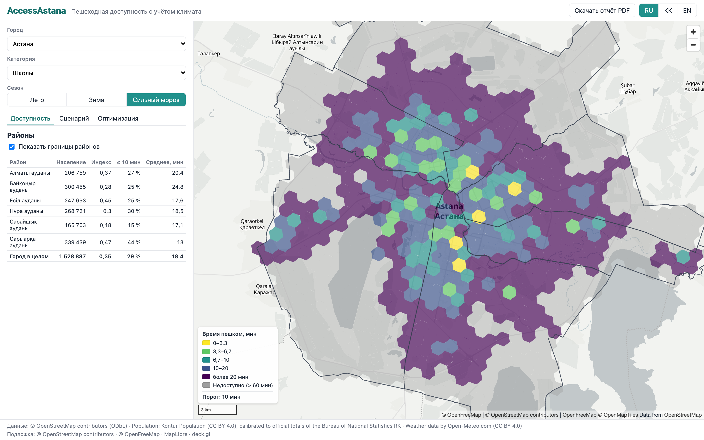
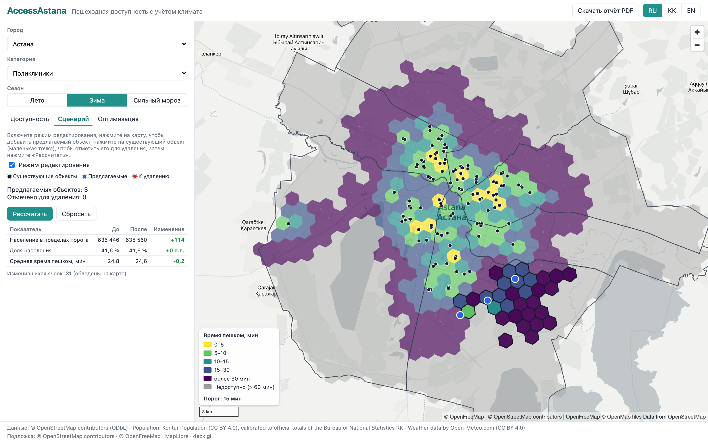
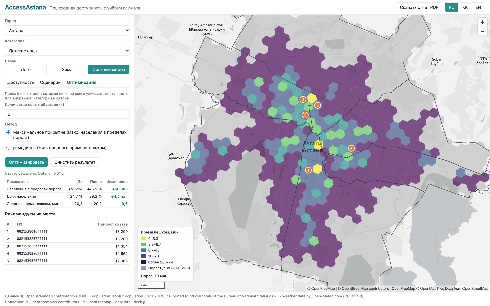
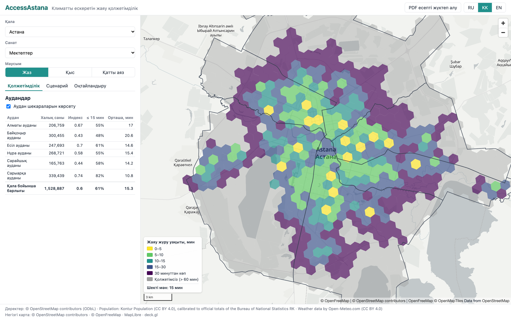

# Руководство пользователя AccessAstana

AccessAstana показывает, сколько минут жителям Астаны идти пешком до ближайших
школы, детского сада, поликлиники, аптеки, остановки общественного транспорта,
продуктового магазина и парка — летом, в обычный зимний день и в сильный
мороз. Сервис позволяет проверить эффект нового объекта и подобрать места для
новых объектов.

**Адрес:** локально `http://localhost:8080`; на сервере — `http://<IP-адрес сервера>/`.
**Браузер:** современный Chrome, Firefox, Safari или Edge с поддержкой WebGL.

## 1. Экран

| Область | Что содержит |
|---|---|
| Шапка | Название, кнопка «Скачать отчёт PDF», переключатель языка **KK / RU / EN** |
| Левая панель | Город, категория, сезон, вкладки «Доступность», «Сценарий», «Оптимизация» |
| Карта | Шестиугольники H3 (≈ 0,74 км²), окрашенные по времени пешком; легенда; масштаб |
| Подвал | Источники данных и лицензии |

## 2. Как читать карту

- **Цвет ячейки** показывает время пешком до ближайшего объекта выбранной категории:
  жёлтый — быстрее всего, тёмно-фиолетовый — дольше всего, серый — недоступно
  в пределах 60 минут или ячейка далеко от пешеходной сети. Границы классов указаны
  в легенде и зависят от порога сезона.
- **Порог** — допустимое время пути в одну сторону: 15 минут летом и зимой,
  10 минут в сильный мороз. Он подписан в легенде («Порог: 15 мин»).
- **Подсказка:** наведите курсор на ячейку, чтобы увидеть её номер H3, время и население.

## 3. Вкладка «Доступность»

1. Выберите **категорию**. Пункт **«15-минутный индекс»** показывает долю из
   7 категорий, доступных в пределах порога: от 0 (ничего рядом) до 1 (всё рядом).
2. Выберите **сезон**:
   - **Лето** — скорость 1,33 м/с, порог 15 мин;
   - **Зима** — 1,235 м/с (плотный снег), порог 15 мин;
   - **Сильный мороз** (индекс охлаждения ветром ≤ −28) — 1,106 м/с (лёд), порог 10 мин.
3. Таблица **«Районы»**: население, индекс, доля жителей в пределах порога и среднее
   время по каждому району и по городу в целом. Флажок **«Показать границы районов»**
   рисует границы районов на карте.

## 4. Вкладка «Сценарий» — «что будет, если…»

1. Выберите конкретную категорию (с индексом сценарии не работают) и сезон.
2. Включите **«Режим редактирования»**. Существующие объекты появятся на карте маленькими точками.
3. **Клик по пустому месту** добавляет предлагаемый объект; можно добавить несколько.
4. **Клик по существующей точке** помечает объект к удалению; повторный клик снимает пометку.
5. Нажмите **«Рассчитать»**. Появится таблица **«До / После / Изменение»**: число
   жителей в пределах порога, их доля и среднее время. Ячейки, в которых время
   изменилось, обведены на карте.
6. **«Сбросить»** очищает сценарий.

## 5. Вкладка «Оптимизация» — где строить

1. Выберите категорию и сезон.
2. Укажите **k**, количество новых объектов (от 1 до 20).
3. Выберите метод:
   - **Максимальное покрытие** — как можно больше жителей впервые попадают в порог;
   - **p-медиана** — минимальное среднее время пешком для всех жителей.
4. Нажмите **«Оптимизировать»**. На карте появятся пронумерованные места. В таблице —
   прирост охвата по каждому месту и показатели «до / после».

## 6. Отчёт и язык

- **«Скачать отчёт PDF»**: таблицы по сезонам, районам, анализ чувствительности и карты.
- **KK / RU / EN**: язык интерфейса; выбор запоминается в браузере.

## 7. Частые вопросы

| Вопрос | Ответ |
|---|---|
| Почему часть ячеек серая? | Ячейка дальше 600 м от пешеходной сети (река, промзона) или объект дальше 60 минут |
| Почему у одних категорий объектов мало? | Объекты берутся из OpenStreetMap. Если объект не нанесён на карту OSM, система его не видит |
| Насколько точны минуты? | Это модельная оценка для взрослого пешехода. Для сравнения сезонов и районов она подходит, но индивидуальное время отличается |
| Почему сценарий не изменил ничего? | Новый объект оказался дальше от жителей, чем существующие |
| Карта не загружается | Проверьте интернет: подложка грузится с OpenFreeMap. Если в панели ошибка, нажмите «Повторить» |

## 8. Источники данных
© OpenStreetMap contributors (ODbL) · Kontur Population (CC BY 4.0) · Open-Meteo.com (CC BY 4.0) ·
Бюро национальной статистики РК · подложка © OpenFreeMap.
